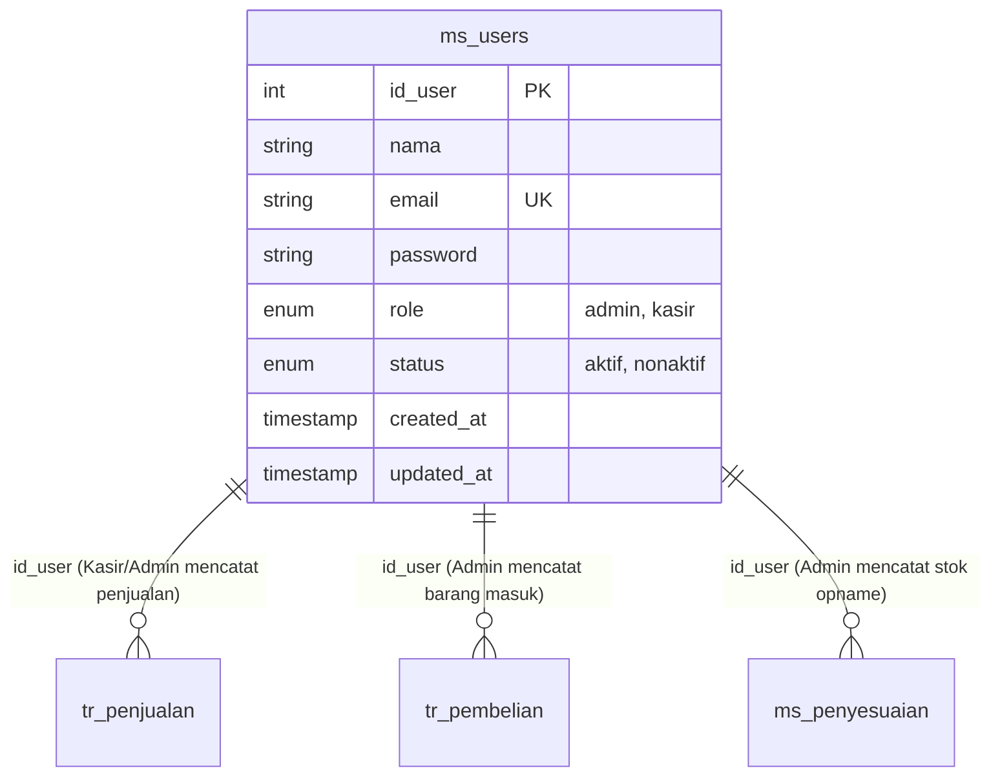

# Dokumentasi Arsitektur Role Admin & Migration: Sistem POS Pradan Motor

> Dokumen ini dirancang sebagai panduan komprehensif, terstruktur, dan terstandarisasi untuk developer dan agen kecerdasan buatan (AI) berikutnya yang akan mengembangkan, memodifikasi, atau memelihara sistem autentikasi, otorisasi, dan database migration pada aplikasi **POS Bengkel Pradan Motor**.

---

## 1. Ringkasan Eksekutif & Konteks Sistem

Aplikasi **POS Bengkel Pradan Motor** merupakan sistem Point of Sale berbasis Laravel yang dirancang khusus untuk manajemen operasional bengkel motor, inventaris suku cadang (spare part), jasa perbaikan/servis, dan pembukuan transaksi.

Sistem otorisasi pengguna menggunakan pendekatan **Role-Based Access Control (RBAC)** berbasis kolom `role` (enum) pada tabel entitas pengguna kustom: `ms_users`.

### Hirarki Role:
1. **`admin` (Administrator / Owner):** Memegang kendali penuh atas konfigurasi sistem, manajemen pengguna (RBAC), master data inventaris, supplier, jasa servis, inventaris barang masuk (restock/pembelian), audit stok opname, serta seluruh laporan keuangan dan penjualan.
2. **`kasir` (Front-Office / Operator Kasir):** Berfokus pada kegiatan operasional sehari-hari: input transaksi penjualan kasir (POS), lookup katalog barang & stok, input data pelanggan servis, dan riwayat transaksi harian.

---

## 2. Arsitektur Database Migration: `ms_users`

Aplikasi ini menggunakan konvensi penamaan tabel berbasis awalan:
- `ms_*` : Master Data (contoh: `ms_users`, `ms_barang`, `ms_kategori`, `ms_jasa`, `ms_pelanggan`, `ms_suppliier`, `ms_penyesuaian`)
- `tr_*` : Transaksi Utama (contoh: `tr_penjualan`, `tr_pembelian`)
- `detail_*` / `*_detail` : Tabel Detail Relasi Transaksi

### 2.1 File Migration Pengguna
- **Path File:** [`database/migrations/2026_10_18_000001_create_ms_users_table.php`](file:///d:/laragon/www/sistem-pos-pradan-motor/database/migrations/2026_10_18_000001_create_ms_users_table.php)
- **Tabel:** `ms_users`

```php
Schema::create('ms_users', function (Blueprint $table) {
    $table->increments('id_user');
    $table->string('nama', 50);
    $table->string('email', 50);
    $table->string('password', 60);
    $table->enum('role', ['admin', 'kasir'])->default('kasir');
    $table->enum('status', ['aktif', 'nonaktif'])->default('aktif');
    $table->timestamp('created_at')->useCurrent();
    $table->timestamp('updated_at')->useCurrent()->useCurrentOnUpdate();

    $table->unique('email', 'uq_users_email');
});
```

### 2.2 Kamus Data (Data Dictionary) `ms_users`

| Nama Kolom | Tipe Data | Nullable | Default | Deskripsi & Aturan Validasi |
| :--- | :--- | :--- | :--- | :--- |
| `id_user` | `INT UNSIGNED` (Auto Increment) | NO | Primary Key | ID unik pengguna sistem. |
| `nama` | `VARCHAR(50)` | NO | - | Nama lengkap staf/admin (Maksimal 50 karakter). |
| `email` | `VARCHAR(50)` | NO | - | Alamat email unik untuk kredensial login (`uq_users_email`). |
| `password` | `VARCHAR(60)` | NO | - | Hash Bcrypt / Laravel Password Hashing. |
| `role` | `ENUM('admin', 'kasir')` | NO | `'kasir'` | Peran pengguna dalam hak akses sistem. |
| `status` | `ENUM('aktif', 'nonaktif')` | NO | `'aktif'` | Status akun. Jika `'nonaktif'`, user dicekal saat login/akses. |
| `created_at`| `TIMESTAMP` | NO | `CURRENT_TIMESTAMP` | Waktu akun dibuat. |
| `updated_at`| `TIMESTAMP` | NO | `CURRENT_TIMESTAMP ON UPDATE` | Waktu akun terakhir diperbarui. |

### 2.3 Relasi Foreign Key terhadap Tabel Lain

Kolom `ms_users.id_user` bertindak sebagai referensi pencatatan audit trail (siapa yang mengeksekusi operasi) pada 3 tabel transaksi krusial:

1. **`tr_penjualan` (Kasir / Transaksi Penjualan)**
   - Migration: [`database/migrations/2026_10_18_000007_create_tr_penjualan_table.php`](file:///d:/laragon/www/sistem-pos-pradan-motor/database/migrations/2026_10_18_000007_create_tr_penjualan_table.php)
   - Foreign Key: `fk_transaksi_user` (`tr_penjualan.id_user` &rarr; `ms_users.id_user`)
2. **`tr_pembelian` (Barang Masuk / Pembelian dari Supplier)**
   - Migration: [`database/migrations/2026_10_18_000009_create_tr_pembelian_table.php`](file:///d:/laragon/www/sistem-pos-pradan-motor/database/migrations/2026_10_18_000009_create_tr_pembelian_table.php)
   - Foreign Key: `fk_bm_user` (`tr_pembelian.id_user` &rarr; `ms_users.id_user`)
   - *Hanya dieksekusi oleh Role Admin.*
3. **`ms_penyesuaian` (Stok Opname / Penyesuaian Stok Fisik)**
   - Migration: [`database/migrations/2026_10_18_000010_create_ms_penyesuaian_table.php`](file:///d:/laragon/www/sistem-pos-pradan-motor/database/migrations/2026_10_18_000010_create_ms_penyesuaian_table.php)
   - Foreign Key: `fk_opname_user` (`ms_penyesuaian.id_user` &rarr; `ms_users.id_user`)
   - *Hanya dieksekusi oleh Role Admin.*



---

## 3. Implementasi Eloquent Model: `User.php`

- **Path File:** [`app/Models/User.php`](file:///d:/laragon/www/sistem-pos-pradan-motor/app/Models/User.php)

Model `User` mewarisi `Illuminate\Foundation\Auth\User as Authenticatable` dan disesuaikan dengan skema `ms_users`:

### Konfigurasi Kunci:
1. **Primary Key Kustom:**
   ```php
   protected $table = 'ms_users';
   protected $primaryKey = 'id_user';
   ```
2. **Mass Assignment:**
   ```php
   protected $fillable = [
       'nama',
       'email',
       'password',
       'role',
       'status',
   ];
   ```
3. **Password Hashing:**
   Menggunakan casts bawaan Laravel `casts()`: `'password' => 'hashed'`.
4. **Non-Token Session (Tanpa `remember_token` di DB):**
   ```php
   public function getRememberTokenName()
   {
       return null;
   }
   ```
5. **Accessors Kompatibilitas:**
   Menyediakan `$user->name` (mapping ke `$user->nama`) dan `$user->id` (mapping ke `$user->id_user`) untuk kompatibilitas standar Laravel Auth & Blade views.

---

## 4. Hak Akses & Matriks Fitur (Admin vs Kasir)

| Modul / Fitur | Role Admin | Role Kasir | Controller Penanggung Jawab |
| :--- | :---: | :---: | :--- |
| **Dashboard** | Analisis Ringkasan Finansial, Stok Kritis, Penjualan, Top Jasa | Transaksi Harian Kasir, Statistik Singkat | `Admin\DashboardController` vs `KasirController` |
| **Manajemen Pengguna (CRUD Staf/Admin)** | **Full CRUD** (Tambah, Ubah, Hapus Akun) | Tidak Ada Akses | `Admin\PenggunaController` |
| **Master Data Barang & Sparepart** | **Full CRUD** (Harga modal, harga jual, stok minimum, dll) | Read-only (Pencarian katalog & stok) | `Admin\BarangController` vs `KasirController@stok` |
| **Kategori Barang** | **Full CRUD** | Tidak Ada Akses | `Admin\KategoriController` |
| **Data Supplier** | **Full CRUD** | Tidak Ada Akses | `Admin\SupplierController` |
| **Data Layanan / Jasa Servis** | **Full CRUD** (Tarif, nama jasa mekanik) | Read-only di Form Transaksi POS | `Admin\LayananController` |
| **Data Pelanggan** | **Full CRUD** | Read & Create saat transaksi kasir | `Admin\PelangganController` vs `KasirController@pelanggan` |
| **Barang Masuk (Restock / Pembelian)** | **Full CRUD** (Menambah stok via faktur supplier) | Tidak Ada Akses | `Admin\BarangMasukController` |
| **Stok Opname (Penyesuaian Fisik)** | **Full Akses** (Audit selisih stok fisik vs sistem) | Tidak Ada Akses | `Admin\StokOpnameController` |
| **Transaksi POS Penjualan** | Riwayat & Hapus Transaksi (Void) | **Input Transaksi Kasir** (Keranjang, Hitung Kembalian, Cetak Struk) | `KasirController@transaksi` & `Admin\RiwayatController` |
| **Laporan & Export** | Laporan Keuangan, Omset, Laba-Rugi, Barang Terlaris | Laporan Penjualan Shift/Kasir | `Admin\LaporanController` vs `KasirController@laporan` |
| **Profil & Ubah Password** | Mengubah nama & password akun admin sendiri | Mengubah password akun kasir sendiri | `Admin\ProfilController` & `AuthController` |

---

## 5. Rute & Controller Khusus Role Admin

Seluruh rute admin dikelompokkan dalam prefix `/admin` dengan alias nama `admin.*` di file [`routes/web.php`](file:///d:/laragon/www/sistem-pos-pradan-motor/routes/web.php).

### 5.1 Daftar Endpoint Admin

```
GET|HEAD   /admin/dashboard ................... admin.dashboard › Admin\DashboardController@index
GET|HEAD   /admin/pengguna .................... admin.pengguna › Admin\PenggunaController@index
POST       /admin/pengguna .................... admin.pengguna.store › Admin\PenggunaController@store
PUT        /admin/pengguna/{user} ............. admin.pengguna.update › Admin\PenggunaController@update
DELETE     /admin/pengguna/{user} ............. admin.pengguna.destroy › Admin\PenggunaController@destroy
GET|HEAD   /admin/barang ...................... admin.barang › Admin\BarangController@index
POST       /admin/barang ...................... admin.barang.store › Admin\BarangController@store
PUT        /admin/barang/{barang} ............. admin.barang.update › Admin\BarangController@update
DELETE     /admin/barang/{barang} ............. admin.barang.destroy › Admin\BarangController@destroy
GET|HEAD   /admin/kategori .................... admin.kategori › Admin\KategoriController@index
POST       /admin/kategori .................... admin.kategori.store › Admin\KategoriController@store
PUT        /admin/kategori/{kategori} ......... admin.kategori.update › Admin\KategoriController@update
DELETE     /admin/kategori/{kategori} ......... admin.kategori.destroy › Admin\KategoriController@destroy
GET|HEAD   /admin/supplier .................... admin.supplier › Admin\SupplierController@index
POST       /admin/supplier .................... admin.supplier.store › Admin\SupplierController@store
PUT        /admin/supplier/{supplier} ......... admin.supplier.update › Admin\SupplierController@update
DELETE     /admin/supplier/{supplier} ......... admin.supplier.destroy › Admin\SupplierController@destroy
GET|HEAD   /admin/layanan ..................... admin.layanan › Admin\LayananController@index
POST       /admin/layanan ..................... admin.layanan.store › Admin\LayananController@store
PUT        /admin/layanan/{jasa} .............. admin.layanan.update › Admin\LayananController@update
DELETE     /admin/layanan/{jasa} .............. admin.layanan.destroy › Admin\LayananController@destroy
GET|HEAD   /admin/pelanggan ................... admin.pelanggan › Admin\PelangganController@index
POST       /admin/pelanggan ................... admin.pelanggan.store › Admin\PelangganController@store
PUT        /admin/pelanggan/{pelanggan} ....... admin.pelanggan.update › Admin\PelangganController@update
DELETE     /admin/pelanggan/{pelanggan} ....... admin.pelanggan.destroy › Admin\PelangganController@destroy
GET|HEAD   /admin/barang-masuk ................ admin.barang-masuk › Admin\BarangMasukController@index
POST       /admin/barang-masuk ................ admin.barang-masuk.store › Admin\BarangMasukController@store
DELETE     /admin/barang-masuk/{pembelian} .... admin.barang-masuk.destroy › Admin\BarangMasukController@destroy
GET|HEAD   /admin/stok-opname ................. admin.stok-opname › Admin\StokOpnameController@index
POST       /admin/stok-opname ................. admin.stok-opname.store › Admin\StokOpnameController@store
DELETE     /admin/stok-opname/{opname} ........ admin.stok-opname.destroy › Admin\StokOpnameController@destroy
GET|HEAD   /admin/riwayat ..................... admin.riwayat › Admin\RiwayatController@index
DELETE     /admin/riwayat/{penjualan} ......... admin.riwayat.destroy › Admin\RiwayatController@destroy
GET|HEAD   /admin/laporan ..................... admin.laporan › Admin\LaporanController@index
GET|HEAD   /admin/profil ...................... admin.profil › Admin\ProfilController@index
```

### 5.2 Fitur Self-Protection pada Admin (`PenggunaController.php`)
Pada modul pengelolaan akun pengguna:
1. **Pencegahan Self-Deactivation:** Admin yang sedang login tidak dapat menonaktifkan akunnya sendiri (`status: nonaktif`).
2. **Pencegahan Self-Deletion:** Admin yang sedang login tidak dapat menghapus akunnya sendiri (`$user->id_user === $request->user()->id_user`).

---

## 6. Autentikasi, Middleware, dan Session Flow

### 6.1 Alur Login & Redirection Berdasarkan Role
Logika login dikendalikan oleh [`app/Http/Controllers/AuthController.php`](file:///d:/laragon/www/sistem-pos-pradan-motor/app/Http/Controllers/AuthController.php):
1. **Brute Force Protection:** Dibatasi maksimal 5 percobaan gagal per 60 detik menggunakan `Illuminate\Support\Facades\RateLimiter`.
2. **Validasi Kredensial:** Autentikasi email dan password via `Auth::attempt()`.
3. **Pengecekan Status Aktif:**
   ```php
   if ($user->status !== 'aktif') {
       Auth::logout();
       return back()->withErrors(['email' => 'Akun Anda telah dinonaktifkan. Silakan hubungi administrator.']);
   }
   ```
4. **Role Routing:**
   - Jika `role === 'admin'` &rarr; Redirect ke route `admin.dashboard`.
   - Jika `role === 'kasir'` &rarr; Redirect ke route `kasir.dashboard`.

### 6.2 Middleware `EnsureUserIsActive`
Terdaftar secara global pada web middleware stack di [`bootstrap/app.php`](file:///d:/laragon/www/sistem-pos-pradan-motor/bootstrap/app.php) via [`app/Http/Middleware/EnsureUserIsActive.php`](file:///d:/laragon/www/sistem-pos-pradan-motor/app/Http/Middleware/EnsureUserIsActive.php). Middleware ini memastikan setiap request dari user yang sudah terautentikasi langsung terputus jika akun dinonaktifkan saat sesi masih aktif.

---

## 7. Data Akun Default (Database Seeder)

Data pengguna awal di-generate melalui [`database/seeders/DatabaseSeeder.php`](file:///d:/laragon/www/sistem-pos-pradan-motor/database/seeders/DatabaseSeeder.php):

| Nama Pengguna | Email | Password | Role | Status |
| :--- | :--- | :--- | :--- | :--- |
| **Tezzy Admin** | `admin@pradanmotor.com` | `password` | `admin` | `aktif` |
| **Admin Utama** | `admin@example.com` | `password` | `admin` | `aktif` |
| **Joo Kasir** | `kasir@pradanmotor.com` | `password` | `kasir` | `aktif` |
| **Kasir Pradan**| `kasir@example.com` | `password` | `kasir` | `aktif` |

---

## 8. Panduan Untuk Agen AI / Developer Selanjutnya

Jika Anda (agen AI atau programmer) bertugas memperluas atau mengubah sistem role dan migration ini, perhatikan aturan-aturan berikut:

1. **Membuat Migration Baru:**
   - **JANGAN** pernah mengubah file migration lama yang sudah pernah di-run di production. Buat migration baru dengan perintah:
     ```bash
     php artisan make:migration alter_ms_users_table --no-interaction
     ```
   - Pertahankan tipe integer yang konsisten: `id_user` adalah `increments` (`INT UNSIGNED`), sehingga setiap foreign key ke `id_user` harus bertipe `$table->unsignedInteger('id_user')`.
2. **Memperluas Role (Misal: Menambah role `owner` atau `mekanik`):**
   - Buat migration untuk memodifikasi kolom enum `role`:
     ```php
     $table->enum('role', ['admin', 'kasir', 'owner', 'mekanik'])->default('kasir')->change();
     ```
   - Update validasi di [`app/Http/Controllers/Admin/PenggunaController.php`](file:///d:/laragon/www/sistem-pos-pradan-motor/app/Http/Controllers/Admin/PenggunaController.php) (`'role' => ['required', 'in:admin,kasir,owner,mekanik']`).
   - Sesuaikan percabangan di [`app/Http/Controllers/AuthController.php`](file:///d:/laragon/www/sistem-pos-pradan-motor/app/Http/Controllers/AuthController.php) dan navigasi di [`resources/views/partials/sidebar.blade.php`](file:///d:/laragon/www/sistem-pos-pradan-motor/resources/views/partials/sidebar.blade.php).
3. **Penyempurnaan Middleware Otorisasi (Rekomendasi Lanjutan):**
   - Saat ini grup `/admin` baru dijaga oleh middleware `auth`. Sangat disarankan untuk membuat middleware `RoleMiddleware` atau `EnsureUserIsAdmin` agar pengguna dengan role `kasir` tidak bisa mengakses URL `/admin/*` secara manual dengan URL tampering.
4. **Standar Kode PHP & Laravel:**
   - Selalu ikuti Laravel Pint formatting (`vendor/bin/pint --format agent`).
   - Gunakan Type Hinting eksplisit dan Return Types pada setiap method controller baru.
