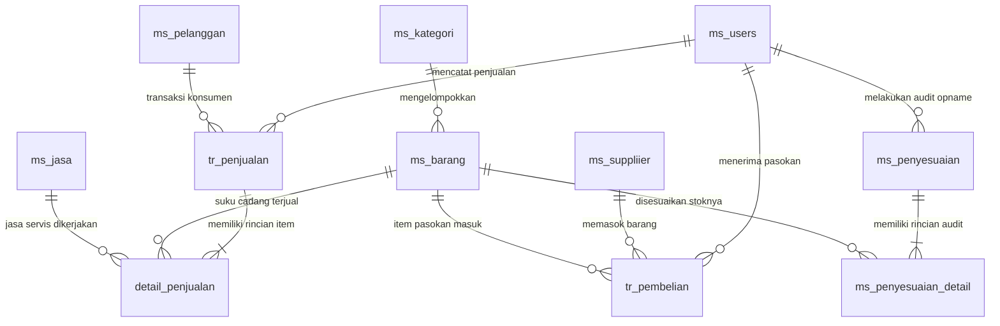
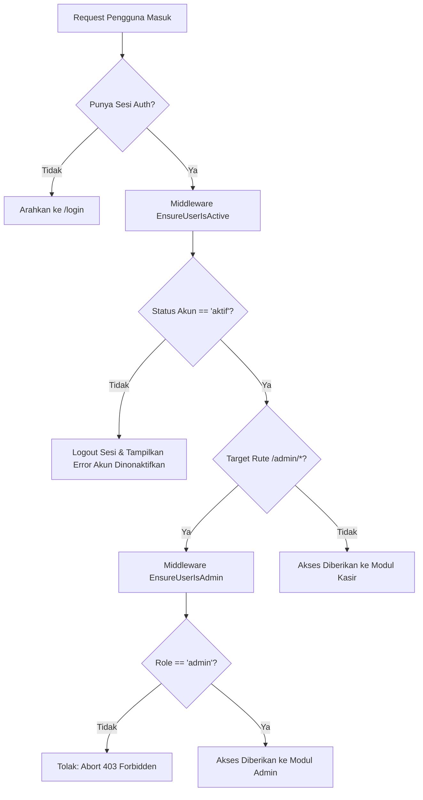
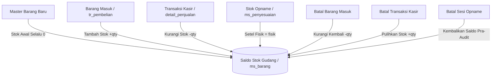
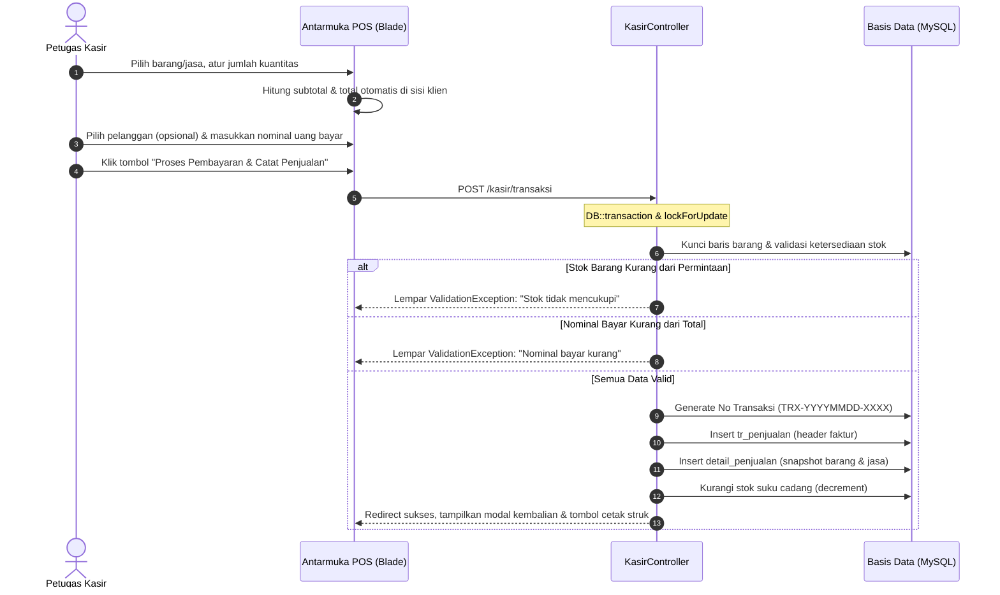
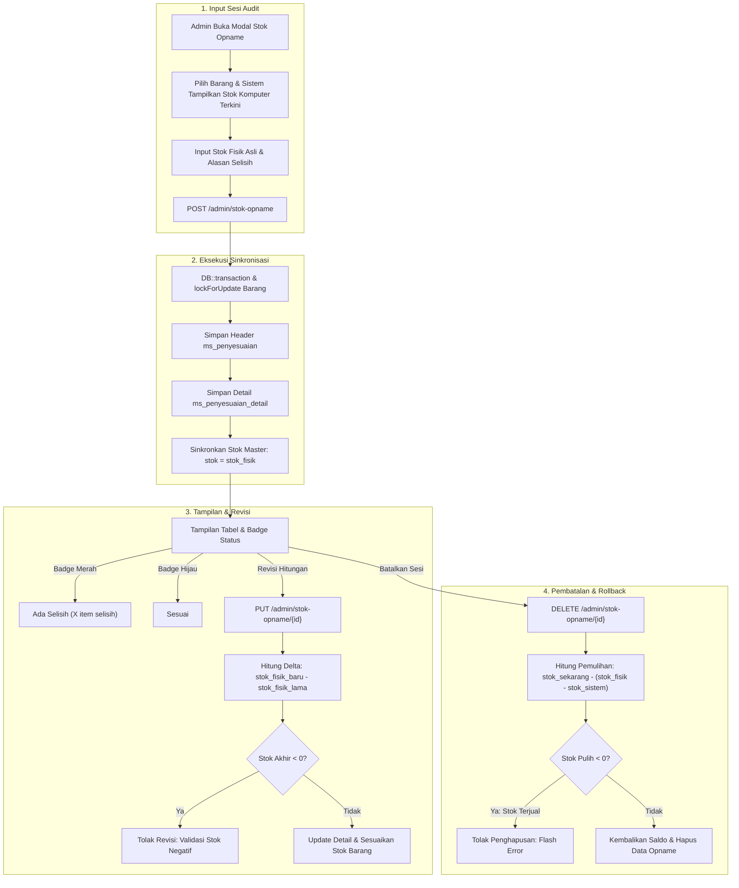

# Dokumentasi Lengkap Alur, Arsitektur, dan Sistem POS Pradan Motor

Dokumen ini merupakan panduan teknis dan operasional komprehensif untuk **Sistem Informasi POS (Point of Sale) & Manajemen Bengkel Motor Pradan Motor**. Dokumen ini mencakup arsitektur sistem, basis data, pemetaan migrasi, mekanisme keamanan, alur bisnis terperinci, siklus inventaris, antarmuka pengguna, pemetaan rute, hingga protokol verifikasi pengujian otomatis.

---

## 1. Ikhtisar Sistem (System Overview)

Sistem POS Pradan Motor adalah aplikasi berbasis web yang dirancang khusus untuk mengelola operasional harian bengkel sepeda motor dan toko suku cadang (*spare part*). Sistem ini mengintegrasikan seluruh transaksi meja kasir, pengadaan suku cadang dari pemasok, audit fisik berkala (stok opname), pengelolaan data pelanggan dan kendaraan, serta pelaporan keuangan terpadu.

### A. Tumpukan Teknologi (Tech Stack)
- **Backend Framework**: [Laravel 12](https://laravel.com/) (berjalan pada lingkungan runtime **PHP 8.4**).
- **Frontend & Styling**: [Tailwind CSS v4](https://tailwindcss.com/) dengan arsitektur modular **Blade Components**.
- **Basis Data**: MySQL / MariaDB (didukung SQLite untuk pengujian otomatis terisolasi).
- **Asset Bundler**: [Vite](https://vite.dev/) terintegrasi dengan Laravel Vite Plugin.
- **Testing Framework**: PHPUnit 11 dengan suite pengujian integrasi fitur penuh (*Feature & Unit Tests*).

### B. Peran Pengguna & Hak Akses (Role-Based Access Control)
Sistem menerapkan pembagian hak akses ketat menjadi 2 (dua) peran operasional:

| Peran | Ruang Lingkup Hak Akses | Deskripsi Operasional |
|---|---|---|
| **Admin** | Penuh (`/admin/*`) | Mengelola seluruh master data (barang, kategori, supplier, jasa, pelanggan, pengguna), penerimaan pasokan barang masuk, audit stok opname, pembatalan transaksi POS beserta pemulihan stok, serta rekapitulasi analitik dan seluruh modul laporan. |
| **Kasir** | Terbatas (`/kasir/*`) | Mengoperasikan meja kasir POS (penjualan suku cadang & pencatatan jasa servis), mendaftarkan dan memperbarui data pelanggan, memantau katalog sisa stok suku cadang (*read-only*), melihat riwayat transaksi kasir, mencetak ulang struk nota, dan melihat rekapitulasi setoran kasir. |

---

## 2. Struktur Basis Data & Pemetaan Lengkap Migration

Sistem menerapkan konvensi penamaan tabel eksplisit dengan prefix:
- `ms_` : *Master Tables* (tabel master referensi dan konfigurasi).
- `tr_` : *Transaction Tables* (tabel transaksi dan mutasi keuangan).
- `detail_` : *Transaction Item Tables* (tabel rincian baris transaksi).

Setiap primary key didefinisikan secara spesifik (contoh: `id_user`, `id_barang`, `id_transaksi`) guna mencegah ambiguitas saat melakukan relasi multi-tabel.

### A. Diagram Relasi Entitas (Entity-Relationship Diagram / ERD)



---

### B. Pemetaan Rinci Seluruh File Migration (Urutan Eksekusi)

Berikut adalah pemetaan ke-14 file migrasi basis data beserta kolom, tipe data, indeks, dan *foreign key constraint*-nya:

#### 1. `0001_01_01_000000_create_users_table.php` (Sistem Bawaan)
- **Tabel `users`**: Autentikasi default Laravel (`id`, `name`, `email`, `email_verified_at`, `password`, `remember_token`, timestamps).
- **Tabel `password_reset_tokens`**: Token penyetelan ulang kata sandi (`email`, `token`, `created_at`).
- **Tabel `sessions`**: Penyimpanan sesi aplikasi (`id`, `user_id`, `ip_address`, `user_agent`, `payload`, `last_activity`).

#### 2. `0001_01_01_000001_create_cache_table.php`
- **Tabel `cache`** & **`cache_locks`**: Manajemen *caching* dan *locking* sistem berbasis database.

#### 3. `0001_01_01_000002_create_jobs_table.php`
- **Tabel `jobs`**, **`job_batches`**, & **`failed_jobs`**: Antrean pekerjaan latar belakang (*background job queue*).

#### 4. `2026_10_18_000001_create_ms_users_table.php` (Master Pengguna POS)
- **Nama Tabel**: `ms_users`
- **Tujuan**: Menyimpan data pegawai bengkel (Admin dan Kasir).
- **Struktur Kolom**:
  - `id_user` (`increments`, PK): Identitas unik pegawai.
  - `nama` (`string(50)`): Nama lengkap pegawai.
  - `email` (`string(50)`, unique: `uq_users_email`): Alamat email untuk login.
  - `password` (`string(60)`): Kata sandi terenkripsi (Bcrypt / Argon2id).
  - `role` (`enum('admin', 'kasir')`, default: `'kasir'`): Peran hak akses sistem.
  - `status` (`enum('aktif', 'nonaktif')`, default: `'aktif'`): Status operasional akun.
  - `created_at` & `updated_at`: Waktu pendaftaran dan pembaruan akun.

#### 5. `2026_10_18_000002_create_ms_kategori_table.php` (Master Kategori Suku Cadang)
- **Nama Tabel**: `ms_kategori`
- **Tujuan**: Klasifikasi jenis suku cadang (contoh: *Oli Mesin, Ban, Busi, Sistem Pengereman, Kelistrikan*).
- **Struktur Kolom**:
  - `id_kategori` (`increments`, PK): Identitas kategori.
  - `nama_kategori` (`string(25)`, unique): Nama klasifikasi barang.

#### 6. `2026_10_18_000003_create_ms_suppliier_table.php` (Master Supplier / Pemasok)
- **Nama Tabel**: `ms_suppliier` *(Catatan: Menggunakan penamaan double 'i' sesuai skema asli rancangan basis data)*
- **Tujuan**: Direktori distributor dan pemasok suku cadang resmi bengkel.
- **Struktur Kolom**:
  - `id_supplier` (`increments`, PK): Identitas supplier.
  - `nama_supplier` (`string(50)`, index: `idx_supplier_nama`): Nama badan usaha distributor.
  - `no_telepon` (`string(15)`, nullable): Nomor telepon atau WhatsApp kontak sales.
  - `alamat` (`string(255)`, nullable): Alamat kantor/gudang supplier.

#### 7. `2026_10_18_000004_create_ms_pelanggan_table.php` (Master Pelanggan)
- **Nama Tabel**: `ms_pelanggan`
- **Tujuan**: Direktori pelanggan pemilik kendaraan motor yang pernah bertransaksi atau servis.
- **Struktur Kolom**:
  - `id_pelanggan` (`increments`, PK): Identitas pelanggan.
  - `nama` (`string(50)`, index: `idx_pelanggan_nama`): Nama lengkap pelanggan.
  - `plat_nomor` (`string(12)`, nullable, index: `idx_pelanggan_plat`): Nomor polisi kendaraan (contoh: `B 1234 XYZ`).
  - `no_telepon` (`string(15)`, nullable): Nomor kontak/WhatsApp pelanggan.
  - `created_at`: Waktu pendaftaran pelanggan.

#### 8. `2026_10_18_000005_create_ms_jasa_table.php` (Master Layanan Jasa Servis)
- **Nama Tabel**: `ms_jasa`
- **Tujuan**: Katalog jenis tindakan mekanik dan ongkos servis bengkel.
- **Struktur Kolom**:
  - `id_jasa` (`increments`, PK): Identitas jasa servis.
  - `nama_jasa` (`string(120)`, unique): Nama pengerjaan servis (contoh: *"Ganti Oli + Filter", "Service Injeksi Lengkap"*).
  - `tarif` (`integer`, default: `0`): Besaran ongkos pengerjaan servis dalam Rupiah (Rp).

#### 9. `2026_10_18_000006_create_ms_barang_table.php` (Master Suku Cadang & Stok)
- **Nama Tabel**: `ms_barang`
- **Tujuan**: Katalog produk suku cadang serta saldo inventaris fisik bengkel.
- **Struktur Kolom**:
  - `id_barang` (`increments`, PK): Identitas produk suku cadang.
  - `id_kategori` (`unsignedInteger`, index: `idx_barang_kategori`): Relasi ke master kategori.
  - `nama_barang` (`string(30)`, index: `idx_barang_nama`): Nama suku cadang.
  - `satuan` (`string(20)`, default: `'pcs'`): Satuan ukuran (contoh: *Pcs, Botol, Set, Tube, Kaleng*).
  - `harga_jual` (`integer`, default: `0`): Harga jual per unit ke konsumen di kasir (Rp).
  - `stok` (`integer`, default: `0`): Jumlah unit fisik yang tersedia di bengkel.
  - `created_at` & `updated_at`: Waktu pencatatan & pergerakan stok.
- **Foreign Keys**:
  - `fk_barang_kategori`: `id_kategori` $\rightarrow$ `ms_kategori(id_kategori)` (`onUpdate: cascade`, `onDelete: restrict`).

#### 10. `2026_10_18_000007_create_tr_penjualan_table.php` (Header Transaksi Kasir)
- **Nama Tabel**: `tr_penjualan`
- **Tujuan**: Header faktur/nota kasir atas setiap transaksi belanja atau servis.
- **Struktur Kolom**:
  - `id_transaksi` (`increments`, PK): Identitas nota penjualan.
  - `id_user` (`unsignedInteger`, index: `idx_transaksi_user`): Petugas kasir yang memproses nota.
  - `id_pelanggan` (`unsignedInteger`, nullable, index: `idx_transaksi_pelanggan`): Konsumen terkait (opsional/bisa pelanggan umum).
  - `id_kendaraan` (`unsignedInteger`, nullable): Slot cadangan entitas motor.
  - `no_transaksi` (`string(25)`, unique): Nomor faktur unik (format: `TRX-YYYYMMDD-XXXX`).
  - `tanggal` (`dateTime`, index: `idx_transaksi_tanggal`): Waktu transaksi diselesaikan.
  - `total` (`integer`, default: `0`): Total tagihan transaksi (suku cadang + jasa servis).
  - `nominal_bayar` (`integer`, default: `0`): Uang tunai yang diserahkan konsumen.
  - `kembalian` (`integer`, nullable): Uang kembalian yang diberikan ke konsumen.
- **Foreign Keys**:
  - `fk_transaksi_user`: `id_user` $\rightarrow$ `ms_users(id_user)` (`onUpdate: cascade`, `onDelete: restrict`).
  - `fk_transaksi_pelanggan`: `id_pelanggan` $\rightarrow$ `ms_pelanggan(id_pelanggan)` (`onUpdate: cascade`, `onDelete: set null` / *soft disconnect*).

#### 11. `2026_10_18_000008_create_detail_penjualan_table.php` (Rincian Item Transaksi POS)
- **Nama Tabel**: `detail_penjualan`
- **Tujuan**: Rincian baris setiap suku cadang atau jasa yang terjual dalam suatu transaksi.
- **Struktur Kolom**:
  - `id_detail` (`increments`, PK): Identitas baris transaksi.
  - `id_transaksi` (`unsignedInteger`, index: `idx_dtrx_transaksi`): Terhubung ke header nota penjualan.
  - `id_barang` (`unsignedInteger`, nullable, index: `idx_dtrx_barang`): Terhubung ke master suku cadang jika jenisnya barang.
  - `id_jasa` (`unsignedInteger`, nullable, index: `idx_dtrx_jasa`): Terhubung ke master jasa jika jenisnya servis.
  - `jenis_item` (`enum('barang', 'jasa')`): Pembeda tipe baris transaksi.
  - `nama_item` (`string(100)`): *Snapshot* nama barang atau jasa saat nota diterbitkan.
  - `harga_satuan` (`integer`): *Snapshot* harga per unit saat transaksi berlangsung.
  - `qty` (`integer`, default: `1`): Kuantitas unit yang dibeli atau volume jasa dikerjakan.
  - `subtotal` (`integer`, nullable): Hasil perkalian matematis `harga_satuan * qty`.
- **Foreign Keys**:
  - `fk_dtrx_transaksi`: `id_transaksi` $\rightarrow$ `tr_penjualan(id_transaksi)` (`onUpdate: cascade`, `onDelete: cascade`).
  - `fk_dtrx_barang`: `id_barang` $\rightarrow$ `ms_barang(id_barang)` (`onDelete: restrict`).
  - `fk_dtrx_jasa`: `id_jasa` $\rightarrow$ `ms_jasa(id_jasa)` (`onDelete: restrict`).

#### 12. `2026_10_18_000009_create_tr_pembelian_table.php` (Pengadaan / Barang Masuk)
- **Nama Tabel**: `tr_pembelian`
- **Tujuan**: Catatan penerimaan suku cadang dari distributor pemasok ke bengkel.
- **Struktur Kolom**:
  - `id_tr_pembelian` (`increments`, PK): Identitas catatan barang masuk.
  - `id_barang` (`unsignedInteger`, nullable, index: `fk_tr_pembelian_ms_barang1_idx`): Suku cadang yang diterima.
  - `id_supplier` (`unsignedInteger`, index: `idx_bm_supplier`): Supplier yang mengirimkan pasokan.
  - `id_user` (`unsignedInteger`, index: `idx_bm_user`): Admin/petugas penerima barang.
  - `no_referensi` (`string(25)`, unique): Nomor surat jalan / faktur pembelian supplier (contoh: `BM-202611-001`).
  - `tanggal` (`date`, index: `idx_bm_tanggal`): Tanggal barang fisik masuk ke bengkel.
  - `jumlah` (`integer`, nullable): Jumlah kuantitas unit yang diterima.
  - `harga_beli` (`integer`, nullable): Harga beli per unit dari distributor (HPP).
  - `subtotal` (`integer`, nullable): Total nilai pengadaan (`jumlah * harga_beli`).
  - `keterangan` (`string(255)`, nullable): Catatan penerimaan fisik barang.
  - `created_at`: Waktu pencatatan di sistem.
- **Foreign Keys**:
  - `fk_bm_supplier`: `id_supplier` $\rightarrow$ `ms_suppliier(id_supplier)` (`onUpdate: cascade`, `onDelete: restrict`).
  - `fk_bm_user`: `id_user` $\rightarrow$ `ms_users(id_user)` (`onUpdate: cascade`, `onDelete: restrict`).
  - `fk_tr_pembelian_ms_barang1`: `id_barang` $\rightarrow$ `ms_barang(id_barang)` (`onUpdate: no action`, `onDelete: no action`).

#### 13. `2026_10_18_000010_create_ms_penyesuaian_table.php` (Header Stok Opname)
- **Nama Tabel**: `ms_penyesuaian`
- **Tujuan**: Header sesi audit penghitungan fisik suku cadang secara berkala.
- **Struktur Kolom**:
  - `id_opname` (`increments`, PK): Identitas unik sesi audit stok opname.
  - `id_user` (`unsignedInteger`, index: `idx_opname_user`): Admin yang melaksanakan sesi audit.
  - `tanggal` (`dateTime`): Tanggal dan jam pelaksanaan audit fisik.
  - `keterangan` (`string(255)`, nullable): Deskripsi atau tujuan sesi audit (contoh: *"Opname Akhir Bulan"*).
- **Foreign Keys**:
  - `fk_opname_user`: `id_user` $\rightarrow$ `ms_users(id_user)` (`onUpdate: cascade`, `onDelete: restrict`).

#### 14. `2026_10_18_000011_create_ms_penyesuaian_detail_table.php` (Rincian Audit Stok Opname)
- **Nama Tabel**: `ms_penyesuaian_detail`
- **Tujuan**: Rincian perbandingan hitungan fisik vs sistem untuk setiap item suku cadang yang diaudit.
- **Struktur Kolom**:
  - `id_detail` (`increments`, PK): Identitas baris detail audit.
  - `id_opname` (`unsignedInteger`, index: `idx_dso_opname`): Terhubung ke sesi audit header.
  - `id_barang` (`unsignedInteger`, index: `idx_dso_barang`): Suku cadang yang diaudit.
  - `stok_sistem` (`integer`): Saldo stok komputer sesaat sebelum audit dijalankan (*snapshot*).
  - `stok_fisik` (`integer`): Saldo fisik aktual hasil hitungan manual di rak etalase/gudang.
  - `alasan` (`text`): Penjelasan rinci penyebab terjadinya selisih barang.
- **Foreign Keys**:
  - `fk_dso_opname`: `id_opname` $\rightarrow$ `ms_penyesuaian(id_opname)` (`onUpdate: cascade`, `onDelete: cascade`).
  - `fk_dso_barang`: `id_barang` $\rightarrow$ `ms_barang(id_barang)` (`onUpdate: cascade`, `onDelete: restrict`).

---

## 3. Arsitektur Keamanan, Autentikasi & Otorisasi

Sistem menerapkan protokol keamanan terpadu di tingkat middleware dan controller:



### A. Alur Login & Brute-Force Rate Limiting
1. **Perlindungan Throttling**: Rute `POST /login` dilindungi oleh `Illuminate\Support\Facades\RateLimiter`. Kunci limiter dibentuk dari kombinasi `Str::transliterate(Str::lower($email).'|'.$request->ip())`.
2. **Ambang Batas**: Jika terjadi 5 kali kegagalan input kata sandi dalam kurun waktu 60 detik, sistem langsung mengunci formulir login dan memunculkan notifikasi hitung mundur sisa detik.
3. **Autentikasi Kredensial**: Menggunakan `Auth::attempt(['email' => $email, 'password' => $password], $remember)`.
4. **Verifikasi Status Operasional Akun**:
   - Meskipun email dan password cocok, jika `status === 'nonaktif'`, sesi langsung di-logout paksa, session di-invalidate, dan pengguna menerima pesan kesalahan: *"Akun Anda telah dinonaktifkan. Silakan hubungi administrator."*

### B. Proteksi Sesi Aktif Berkelanjutan (`EnsureUserIsActive`)
- Middleware `EnsureUserIsActive` didaftarkan secara global pada grup `web`.
- Pada setiap request HTTP, sistem memeriksa apakah status akun pengguna yang sedang login masih `aktif`. Jika seorang Admin menonaktifkan akun kasir di tengah jam operasional, kasir tersebut akan langsung ter-logout secara otomatis pada klik request berikutnya.

### C. Pembatasan Hak Akses Administrator (`EnsureUserIsAdmin`)
- Alias rute: `admin`.
- Melindungi seluruh grup rute `/admin/*`. Memvalidasi `Auth::user()->role === 'admin'`. Jika kasir mencoba mengakses URL admin, sistem langsung menghentikan request dengan respons `abort(403, 'Akses ditolak.')`.

### D. Keamanan Pembaruan Password Mandiri (`profile.password.update`)
- Rute `POST /profil/password` mewajibkan pengisian `current_password` yang diverifikasi secara kriptografis menggunakan aturan validasi `'current_password'`.
- Kata sandi baru wajib minimal 8 karakter, wajib dikonfirmasi (`confirmed`), dan wajib berbeda dari kata sandi lama (`different:current_password`).

### E. Perlindungan Self-Action Akun Administrator
- Pada `Admin\PenggunaController`, terdapat validasi khusus:
  - Admin dilarang menonaktifkan status akun miliknya sendiri (`status = nonaktif`).
  - Admin dilarang menghapus akun miliknya sendiri (`destroy`).
  - Hal ini menjamin sistem tidak akan pernah kehilangan akses administrator tertinggi (*lockout prevention*).

---

## 4. Alur Bisnis Inti & Siklus Inventaris

### A. Siklus Hidup & Integritas Stok (Stock Lifecycle)

Perubahan stok barang dikelola dengan penguncian baris database (`lockForUpdate`) dan transaksi database atomik (`DB::transaction`):



#### 1. Aturan Inisialisasi Master Barang
- Saat Admin menambahkan suku cadang baru via menu **Master Barang**, stok **selalu diinisialisasi 0**.
- Input stok sengaja ditiadakan dari formulir master barang agar setiap unit suku cadang memiliki dokumen sumber penerimaan yang sah (Nomor Referensi Faktur Pembelian).
- Pembaruan nama, kategori, satuan, dan harga jual pada master barang sama sekali tidak mengubah nilai kolom `stok`.

#### 2. Penambahan Stok (Barang Masuk / Pembelian)
- Satu-satunya jalan legal untuk memasukkan stok baru ke bengkel adalah melalui menu **Barang Masuk (`tr_pembelian`)**.
- Ketika pasokan dicatat, stok barang bertambah secara atomik:
  ```php
  $barang->increment('stok', $jumlah);
  ```

#### 3. Pengurangan Stok (Penjualan Kasir POS)
- Kasir memproses transaksi suku cadang.
- Sistem mengunci baris barang terkait (`lockForUpdate()`), memverifikasi bahwa `stok >= qty`, kemudian mengurangi saldo stok:
  ```php
  $barang->decrement('stok', $qty);
  ```

#### 4. Penyelarasan Fisik (Stok Opname)
- Dilakukan saat audit berkala untuk menyelaraskan catatan komputer dengan fisik di rak gudang.
- Sistem mencatat snapshot `stok_sistem` sesaat sebelum audit, mencatat `stok_fisik`, menghitung selisih, dan menyelaraskan saldo barang:
  ```php
  $barang->update(['stok' => $stok_fisik]);
  ```

#### 5. Proteksi Anti-Stok Negatif pada Pembatalan
- Jika catatan barang masuk atau sesi stok opname hendak dibatalkan/dihapus oleh Admin, sistem menghitung apakah pengurangan stok tersebut akan menyebabkan stok menjadi minus ($< 0$) akibat sebagian suku cadang sudah terlanjur terjual di kasir pada transaksi lain.
- Jika terdeteksi saldo akhir menjadi negatif, proses pembatalan **ditolak secara tegas** disertai pesan penjelasan yang informatif.

---

### B. Alur Transaksi Kasir POS (Point of Sale)



#### Rincian Mekanisme Transaksi POS:
1. **Dukungan Keranjang Campuran (*Mixed Cart*)**:
   - Dalam satu nota kasir, konsumen dapat membeli suku cadang fisik (oli, busi, kanvas rem) sekaligus jasa perbaikan mekanik (ongkos pasang, servis karburator, ganti ban).
2. **Snapshot Data Transaksi**:
   - Pada tabel `detail_penjualan`, nama item (`nama_item`) dan harga satuan (`harga_satuan`) disimpan sebagai nilai snapshot statis pada detik transaksi dicatat. Kenaikan harga atau perubahan nama suku cadang di kemudian hari tidak akan pernah mengubah laporan keuangan transaksi masa lampau.
3. **Format Nomor Transaksi Unik**:
   - Dibuat secara otomatis dengan format: `TRX-YYYYMMDD-XXXX` (contoh: `TRX-20261115-0001`). Jika nomor urut bentrok, sistem secara otomatis menambahkan kode acak 5 karakter alfanumerik unik (`TRX-YYYYMMDD-A8F2K`).
4. **Cetak Struk Transaksi POS**:
   - Menggunakan tampilan khusus cetak struk termal (lebar 58mm / 80mm) yang dioptimalkan dengan CSS `@media print`, menyajikan nama bengkel, alamat, nomor nota, kasir, waktu transaksi, rincian barang/jasa, total, uang bayar, dan kembalian.

---

### C. Alur Pengadaan Barang Masuk (Pembelian dari Supplier)

Modul **Barang Masuk (`tr_pembelian`)** digunakan oleh Administrator untuk mencatat kedatangan suku cadang dari pemasok.

#### 1. Fleksibilitas Input (Single Item & Batch Multi-Item)
- **Single Item**: Untuk pencatatan cepat 1 jenis suku cadang yang masuk.
- **Batch Multi-Item**: Mendukung form dinamis berbasis JavaScript di mana Admin dapat menambahkan baris suku cadang tak terbatas (`+ Tambah Barang`) dalam satu nomor faktur pengiriman.
- **Penanganan Nomor Referensi Batch**:
  - Jika satu faktur supplier memuat 3 jenis barang dengan nomor referensi `SJ-9988`, sistem secara otomatis mencatatnya menjadi `SJ-9988-1`, `SJ-9988-2`, dan `SJ-9988-3`, sehingga setiap baris mutasi stok memiliki audit trail yang terpisah namun tetap terhubung secara logis.

#### 2. Pembatalan Barang Masuk & Proteksi Stok Negatif
- Jika Admin membatalkan catatan penerimaan barang masuk:
  1. Sistem mengunci data barang dengan `lockForUpdate()`.
  2. Memeriksa: `if ($barang->stok < $pembelian->jumlah)`.
  3. Jika stok di rak saat ini lebih kecil dari kuantitas yang dibatalkan (karena sebagian unit sudah terjual di meja kasir), sistem membatalkan transaksi penghapusan dan memberikan peringatan:
     *"Penghapusan ditolak: Stok barang 'X' saat ini (Y) tidak mencukupi untuk dikurangi Z karena sebagian stok telah digunakan pada transaksi lain."*
  4. Jika stok mencukupi, stok dikurangi (`decrement`) dan baris pembelian dihapus.

---

### D. Alur Mendalam Modul Stok Opname (Audit Fisik)

Stok Opname adalah proses mencocokkan jumlah stok fisik di gudang/rak bengkel dengan stok yang tercatat pada sistem komputer. Perbedaan dapat terjadi karena barang rusak, hilang, salah catat saat penerimaan, atau kebocoran kemasan oli.



#### 1. Antarmuka Interaktif Sisi Klien
- **Live Difference Preview**: Saat Admin mengetik angka stok fisik di modal input, sistem langsung menampilkan kalkulator selisih secara real-time tanpa perlu me-reload halaman:
  - Jika fisik > sistem: Badge hijau bertuliskan `Lebih +X (Unit)`.
  - Jika fisik < sistem: Badge merah bertuliskan `Kurang -X (Unit)`.
  - Jika fisik == sistem: Badge abu-abu bertuliskan `Sesuai`.
- **Chips Alasan Cepat**: Disediakan tombol chip sekali-klik untuk mengisi alasan yang sering terjadi: *"Barang pecah/bocor"*, *"Hilang / Selisih Rak"*, *"Salah hitung penerimaan"*, *"Barang rusak / aus"*.
- **Pencegahan Item Duplikat**: Dropdown pemilihan barang mencegah pemilihan barang yang sama lebih dari satu kali dalam satu sesi batch audit.

#### 2. Operasi CREATE (`store`)
- Menerima input single item maupun batch multi-item.
- Menyimpan snapshot `stok_sistem` sesaat sebelum audit, menyimpan `stok_fisik`, dan langsung meng-update saldo inventaris: `$barang->update(['stok' => $stok_fisik])`.

#### 3. Operasi UPDATE (`update` - Revisi Hasil Hitung)
- Jika petugas salah menghitung atau menemukan barang yang terselip setelah sesi opname tersimpan, sistem menyediakan tombol edit.
- **Perhitungan Delta**:
  $$\Delta = \text{stok\_fisik\_baru} - \text{stok\_fisik\_lama}$$
  $$\text{stok\_sistem\_akhir} = \text{stok\_barang\_terkini} + \Delta$$
- **Validasi Stok Negatif**: Jika suku cadang telah terjual di kasir dan revisi baru menurunkan jumlah fisik sedemikian rupa sehingga $\text{stok\_sistem\_akhir} < 0$, sistem melempar `ValidationException` dan menolak perubahan demi menjaga integritas data.

#### 4. Operasi DELETE (`destroy` - Pembatalan Sesi & Rollback)
- Menghapus sesi opname sekaligus **mengembalikan saldo stok ke kondisi sebelum opname dilakukan**.
- **Rumus Pemulihan Saldo**:
  $$\text{selisih\_opname} = \text{stok\_fisik} - \text{stok\_sistem}$$
  $$\text{stok\_pulih} = \text{stok\_saat\_ini} - \text{selisih\_opname}$$
- **Contoh Kasus Proteksi**:
  - Saat opname, stok sistem 5 botol, fisik dihitung 12 botol (selisih $+7$).
  - Setelah opname, 10 botol terjual di kasir, sehingga sisa stok saat ini tinggal 2 botol.
  - Jika opname ini dibatalkan, sistem harus mengurangi 7 botol ($2 - 7 = -5$).
  - Sistem mendeteksi potensi stok negatif, menolak pembatalan, me-rollback transaksi database, dan memunculkan notifikasi error ke Admin.

---

### E. Alur Pembatalan Transaksi Kasir oleh Administrator

Jika terjadi salah input di kasir atau pelanggan membatalkan pembelian setelah pembayaran tercatat:
1. Administrator membuka menu **Riwayat Transaksi** (`/admin/riwayat`).
2. Admin menekan tombol hapus/batal pada nota terkait.
3. Sistem menjalankan transaksi database atomik:
   - Mengambil seluruh baris pada `detail_penjualan` yang berjenis `'barang'`.
   - Mengunci baris `ms_barang` terkait dengan `lockForUpdate()`.
   - Mengembalikan kuantitas barang ke rak: `$barang->increment('stok', $detail->qty)`.
   - Menghapus header `tr_penjualan` (seluruh `detail_penjualan` terhapus otomatis via *cascade delete* di level database).
4. Stok suku cadang kembali utuh dan siap dijual kembali.

---

### F. Aturan Integritas Penghapusan Master Data (Referential Integrity)

Untuk mencegah data anak kehilangan induk (*orphaned records*) dan menjaga validitas rekapitulasi keuangan:
- **Master Barang**: Dilarang dihapus jika ID barang pernah tercatat di `detail_penjualan`, `tr_pembelian`, atau `ms_penyesuaian_detail`.
- **Master Kategori**: Dilarang dihapus jika masih ada produk suku cadang yang bernaung di bawah kategori tersebut.
- **Master Supplier**: Dilarang dihapus jika memiliki riwayat pengadaan pada `tr_pembelian`.
- **Master Layanan Jasa**: Dilarang dihapus jika pernah masuk dalam rincian transaksi servis pada `detail_penjualan`.
- **Master Pelanggan**: Menerapkan mekanisme **Soft-Disconnect**; saat data pelanggan dihapus, relasi `id_pelanggan` pada tabel transaksi `tr_penjualan` disetel menjadi `NULL` (`onDelete: set null`), sehingga data riwayat omzet dan nominal keuangan nota tidak hilang.

---

## 5. Modul Pelaporan & Analitik (Reporting Engine)

### A. Modul Laporan Admin (`Admin\LaporanController`)
Mendukung filter periode rentang tanggal (`tanggal_mulai` s/d `tanggal_akhir`) dengan 4 (empat) jenis klasifikasi:

1. **Laporan Penjualan (POS)**:
   - Menyajikan daftar seluruh nota penjualan kasir.
   - Metrik Ringkasan: Total Omzet Penjualan (Rp), Total Frekuensi Transaksi, dan Rata-rata Nilai Transaksi (*Average Basket Size*).
2. **Laporan Pembelian (Barang Masuk)**:
   - Menyajikan pengadaan barang dari supplier.
   - Metrik Ringkasan: Total Pengeluaran Pembelian (Rp), Total Unit Suku Cadang Masuk, dan Frekuensi Surat Jalan Masuk.
3. **Laporan Mutasi Stok (Stok Opname)**:
   - Menyajikan catatan audit fisik barang.
   - Metrik Ringkasan: Total Baris Barang Diaudit, Akumulasi Unit Selisih (Fisik vs Komputer), dan Alasan Selisih.
4. **Laporan Jasa Servis Bengkel**:
   - Menyajikan seluruh pengerjaan mekanik yang dikerjakan.
   - Metrik Ringkasan: Total Pendapatan Ongkos Servis (Rp), Total Frekuensi Tindakan Mekanik, dan Jumlah Transaksi Servis.

### B. Modul Laporan Kasir (`KasirController@laporan`)
- Menampilkan rekapitulasi khusus operasional kasir yang sedang bertugas.
- Menghitung total penerimaan uang tunai, setoran kasir, jumlah pelanggan yang dilayani, serta daftar transaksi harian untuk memudahkan serah terima pergantian shift kerja (*shift handover*).

---

## 6. Peta Rute Lengkap Sistem (Routing & Controller Map)

Seluruh rute didefinisikan pada file [routes/web.php](file:///d:/laragon/www/sistem-pos-pradan-motor/routes/web.php).

### A. Rute Publik, Autentikasi & Profil Akun
| Method | URI | Nama Rute | Controller & Method | Middleware | Deskripsi Fungsi |
|---|---|---|---|---|---|
| `GET` | `/` | - | Closure | - | Pengalihan otomatis ke dashboard sesuai peran atau form login |
| `GET` | `/login` | `login` | `AuthController@showLoginForm` | `guest` | Menampilkan formulir login |
| `POST` | `/login` | - | `AuthController@login` | `guest` | Autentikasi kredensial & brute force limiter |
| `POST` | `/logout` | `logout` | Closure / `AuthController` | `auth` | Menghapus sesi dan keluar aplikasi |
| `GET` | `/registrasi` | `register` | Closure | - | Halaman registrasi akun |
| `POST` | `/profil/password`| `profile.password.update`| Closure | `auth` | Pembaruan kata sandi akun aktif |

### B. Modul Kasir (`/kasir/*` - Middleware: `auth`)
| Method | URI | Nama Rute | Controller & Method | Deskripsi Fungsi |
|---|---|---|---|---|
| `GET` | `/kasir/dashboard` | `kasir.dashboard` | `KasirController@dashboard` | Ringkasan transaksi kasir & stok kritis |
| `GET` | `/kasir/transaksi` | `kasir.transaksi` | `KasirController@transaksi` | Antarmuka kasir penjualan POS (stok dinamis) |
| `GET` | `/kasir/transaksi/stok` | `kasir.transaksi.stok` | `KasirController@stokJson` | Endpoint JSON stok real-time (read-only) |
| `GET` | `/kasir/transaksi/{penjualan}/struk` | `kasir.transaksi.struk` | `KasirController@struk` | Cetak struk thermal 58mm/80mm (otorisasi kasir) |
| `POST` | `/kasir/transaksi` | `kasir.transaksi.store` | `KasirController@storeTransaksi` | Pemrosesan pembayaran & pemotongan stok |
| `GET` | `/kasir/pelanggan` | `kasir.pelanggan` | `Kasir\PelangganController@index` | Direktori pelanggan bengkel |
| `POST` | `/kasir/pelanggan` | `kasir.pelanggan.store` | `Kasir\PelangganController@store` | Pendaftaran pelanggan baru |
| `PUT` | `/kasir/pelanggan/{pelanggan}`| `kasir.pelanggan.update`| `Kasir\PelangganController@update`| Pembaruan data pelanggan |
| `DELETE`| `/kasir/pelanggan/{pelanggan}`| `kasir.pelanggan.destroy`| `Kasir\PelangganController@destroy`| Hapus pelanggan (soft-disconnect) |
| `GET` | `/kasir/stok` | `kasir.stok` | `KasirController@stok` | Katalog sisa stok barang (*read-only*) |
| `GET` | `/kasir/riwayat` | `kasir.riwayat` | `KasirController@riwayat` | Riwayat transaksi kasir bersangkutan |
| `GET` | `/kasir/laporan` | `kasir.laporan` | `KasirController@laporan` | Rekapitulasi penjualan & setoran kasir |
| `GET` | `/kasir/profil` | `kasir.profil` | `KasirController@profil` | Informasi profil akun kasir |

### C. Modul Administrator (`/admin/*` - Middleware: `auth`, `admin`)
| Method | URI | Nama Rute | Controller & Method | Deskripsi Fungsi |
|---|---|---|---|---|
| `GET` | `/admin/dashboard` | `admin.dashboard` | `Admin\DashboardController@index` | Analitik omzet, transaksi, stok menipis |
| `GET` | `/admin/pengguna` | `admin.pengguna` | `Admin\PenggunaController@index` | Daftar master akun pegawai |
| `POST` | `/admin/pengguna` | `admin.pengguna.store` | `Admin\PenggunaController@store` | Tambah pegawai baru (Admin/Kasir) |
| `PUT` | `/admin/pengguna/{user}` | `admin.pengguna.update` | `Admin\PenggunaController@update` | Perbarui role, status, atau kata sandi |
| `DELETE`| `/admin/pengguna/{user}` | `admin.pengguna.destroy`| `Admin\PenggunaController@destroy`| Hapus akun pegawai (proteksi akun sendiri)|
| `GET` | `/admin/barang` | `admin.barang` | `Admin\BarangController@index` | Katalog master suku cadang |
| `POST` | `/admin/barang` | `admin.barang.store` | `Admin\BarangController@store` | Tambah suku cadang baru (stok awal 0) |
| `PUT` | `/admin/barang/{barang}` | `admin.barang.update` | `Admin\BarangController@update` | Perbarui nama/harga/kategori barang |
| `DELETE`| `/admin/barang/{barang}` | `admin.barang.destroy` | `Admin\BarangController@destroy` | Hapus barang (hanya jika belum bertransaksi)|
| `GET` | `/admin/kategori` | `admin.kategori` | `Admin\KategoriController@index` | Daftar master klasifikasi kategori |
| `POST` | `/admin/kategori` | `admin.kategori.store` | `Admin\KategoriController@store` | Tambah kategori baru |
| `PUT` | `/admin/kategori/{kategori}`| `admin.kategori.update`| `Admin\KategoriController@update`| Perbarui nama kategori |
| `DELETE`| `/admin/kategori/{kategori}`| `admin.kategori.destroy`| `Admin\KategoriController@destroy`| Hapus kategori (dicegah bila berelasi) |
| `GET` | `/admin/supplier` | `admin.supplier` | `Admin\SupplierController@index` | Direktori master pemasok / supplier |
| `POST` | `/admin/supplier` | `admin.supplier.store` | `Admin\SupplierController@store` | Tambah data supplier baru |
| `PUT` | `/admin/supplier/{supplier}`| `admin.supplier.update`| `Admin\SupplierController@update`| Perbarui kontak & alamat supplier |
| `DELETE`| `/admin/supplier/{supplier}`| `admin.supplier.destroy`| `Admin\SupplierController@destroy`| Hapus supplier (dicegah bila berelasi) |
| `GET` | `/admin/layanan` | `admin.layanan` | `Admin\LayananController@index` | Katalog tarif & jasa servis mekanik |
| `POST` | `/admin/layanan` | `admin.layanan.store` | `Admin\LayananController@store` | Tambah jenis jasa servis baru |
| `PUT` | `/admin/layanan/{jasa}` | `admin.layanan.update` | `Admin\LayananController@update` | Perbarui tarif & nama pengerjaan servis |
| `DELETE`| `/admin/layanan/{jasa}` | `admin.layanan.destroy` | `Admin\LayananController@destroy` | Hapus jasa (dicegah bila ada riwayat) |
| `GET` | `/admin/pelanggan` | `admin.pelanggan` | `Admin\PelangganController@index` | Direktori master pelanggan bengkel |
| `POST` | `/admin/pelanggan` | `admin.pelanggan.store` | `Admin\PelangganController@store` | Tambah pelanggan baru |
| `PUT` | `/admin/pelanggan/{pelanggan}`| `admin.pelanggan.update`| `Admin\PelangganController@update`| Perbarui nama/plat/telepon pelanggan |
| `DELETE`| `/admin/pelanggan/{pelanggan}`| `admin.pelanggan.destroy`| `Admin\PelangganController@destroy`| Hapus pelanggan (soft-disconnect) |
| `GET` | `/admin/barang-masuk` | `admin.barang-masuk` | `Admin\BarangMasukController@index` | Riwayat penerimaan pasokan barang |
| `POST` | `/admin/barang-masuk` | `admin.barang-masuk.store`| `Admin\BarangMasukController@store`| Tambah pasokan (single/batch) & tambah stok|
| `DELETE`| `/admin/barang-masuk/{pembelian}`| `admin.barang-masuk.destroy`| `Admin\BarangMasukController@destroy`| Batalkan penerimaan & rollback stok |
| `GET` | `/admin/stok-opname` | `admin.stok-opname` | `Admin\StokOpnameController@index` | Riwayat audit penyesuaian fisik |
| `POST` | `/admin/stok-opname` | `admin.stok-opname.store`| `Admin\StokOpnameController@store`| Simpan sesi audit & sinkronkan stok |
| `PUT` | `/admin/stok-opname/{opname}`| `admin.stok-opname.update`| `Admin\StokOpnameController@update`| Revisi audit fisik & delta kalkulasi stok |
| `DELETE`| `/admin/stok-opname/{opname}`| `admin.stok-opname.destroy`| `Admin\StokOpnameController@destroy`| Batalkan audit & kembalikan saldo awal |
| `GET` | `/admin/riwayat` | `admin.riwayat` | `Admin\RiwayatController@index` | Riwayat transaksi seluruh kasir |
| `GET` | `/admin/riwayat/{penjualan}/struk`| `admin.riwayat.struk`| `Admin\RiwayatController@struk`| Cetak struk thermal 58mm/80mm (otorisasi admin) |
| `DELETE`| `/admin/riwayat/{penjualan}`| `admin.riwayat.destroy`| `Admin\RiwayatController@destroy`| Batalkan transaksi POS & kembalikan stok |
| `GET` | `/admin/laporan` | `admin.laporan` | `Admin\LaporanController@index` | Rekapitulasi laporan penjualan, beli, stok |
| `GET` | `/admin/profil` | `admin.profil` | `Admin\ProfilController@index` | Informasi profil akun administrator |

---

## 7. Desain Komponen UI & Utilitas JavaScript Global

Antarmuka sistem dikembangkan menggunakan arsitektur komponen Blade di direktori `resources/views/components/`:

### A. Katalog Komponen Blade Utama
- `<x-page-header>`: Menampilkan header halaman yang seragam, judul utama, sub-judul kontekstual, ikon halaman, dan tombol aksi utama.
- `<x-summary-card>`: Kartu ringkasan metrik statistik dengan indikator angka tebal, label, ikon berwarna, dan badge status.
- `<x-table>`: Komponen tabel data responsif dilengkapi fitur pencarian instan sisi klien (`searchable="true"`), penomoran otomatis, dan paginasi interaktif.
- `<x-modal>`: Dialog modal serbaguna untuk form POST, PUT, DELETE, maupun konfirmasi peringatan bahaya (*danger confirmation*).
- `<x-button-action>`: Tombol aksi miniatur di baris tabel untuk tindakan `info` (lihat detail), `edit`, `delete`, dan `print`.
- `<x-badge>`: Label indikator status berwarna semantik (`success`, `danger`, `warning`, `info`) dengan dukungan ikon terintegrasi.
- `<x-input>` & `<x-select>`: Komponen input formulir terstandarisasi dengan label, pesan error validasi otomatis, dan atribut aksesibilitas.
- `<x-sidebar>` & `<x-topbar>`: Navigasi samping dan atas yang secara dinamis menampilkan menu aktif berdasarkan peran pengguna (`Admin` atau `Kasir`).

### B. Mekanisme Loading Tombol Simpan & Anti Double-Submit Global
Diterapkan pada [resources/views/layouts/app.blade.php](file:///d:/laragon/www/sistem-pos-pradan-motor/resources/views/layouts/app.blade.php):
- **Otomatis untuk Semua Formulir Non-GET**: Setiap form yang disubmit via method `POST`, `PUT`, `PATCH`, atau `DELETE` (termasuk seluruh form modal `<x-modal>`, profil, dan kasir POS) secara otomatis memicu handler ini. Form filter dan pencarian (`GET`) dikecualikan.
- **Pengecekan Validitas HTML5**: Tombol tidak akan berubah atau terkunci jika formulir belum lolos validasi browser (misal: field bertanda `required` masih kosong).
- **Penyesuaian Label Kontekstual**:
  - Tombol Simpan / Tambah / Perbarui $\rightarrow$ Spinner + `Menyimpan...`
  - Tombol Hapus $\rightarrow$ Spinner + `Menghapus...`
  - Tombol Kasir / Checkout / Bayar $\rightarrow$ Spinner + `Memproses...`
  - Tombol Ekspor / Unduh $\rightarrow$ Spinner + `Mengunduh...`
- **Pencegahan Double-Submit**:
  - Mempertahankan lebar asli tombol (`minWidth = submitBtn.offsetWidth + 'px'`) agar tombol tidak menyusut atau menggeser tata letak.
  - Mematikan pointer interaksi (`pointerEvents = 'none'`).
  - Menambahkan styling `opacity-75 cursor-not-allowed`.
  - Menonaktifkan tombol secara resmi (`disabled = true`).

### C. Dialog Alert Universal Berbasis Modal (`#modal-global-alert`)
- Menggantikan fungsi popup bawaan peramban (`window.alert()`) yang kaku dengan komponen modal elegan `<x-modal size="sm">`.
- Fungsi JavaScript terpadu:
  ```javascript
  window.showAlertModal(message, title = 'Pemberitahuan', type = 'warning');
  ```
  Mendukung 4 variasi tipe semantik dengan aksen warna dan ikon yang serasi:
  - `'warning'`: Aksen kuning amber dengan ikon peringatan.
  - `'danger'` / `'error'`: Aksen merah rose dengan ikon bahaya.
  - `'success'`: Aksen hijau emerald dengan ikon centang sukses.
  - `'info'`: Aksen biru dengan ikon informasi.
- Fungsi standar `window.alert = function(msg) { window.showAlertModal(msg); }` meng-override alert di seluruh halaman sistem secara otomatis.

---

## 8. Panduan Verifikasi & Pengujian Otomatis (Quality Assurance)

Seluruh logika bisnis, integritas data inventaris, alur kasir, stok opname, serta pembatasan peran diuji secara menyeluruh melalui rangkaian automated tests pada [tests/Feature/AdminCrudTest.php](file:///d:/laragon/www/sistem-pos-pradan-motor/tests/Feature/AdminCrudTest.php) dan `tests/Feature/ExampleTest.php`.

### A. Cakupan Pengujian (42 Skenario Uji)
1. **Autentikasi & Otorisasi**:
   - Pembatasan brute-force rate limiter pada form login.
   - Penolakan login dan pemblokiran sesi untuk akun berstatus `nonaktif`.
   - Pencegahan kasir mengakses modul admin (`403 Forbidden`).
   - Pencegahan admin menonaktifkan atau menghapus akunnya sendiri.
2. **Master Data CRUD & Validasi Integritas**:
   - Validasi keunikan nama kategori, email pengguna, dan nama jasa servis.
   - Validasi batas karakter maksimal (nama barang 30 char, satuan 20 char, supplier 50 char).
   - Inisialisasi stok awal barang selalu 0 dan tidak terpengaruh saat edit master.
   - Penolakan penghapusan barang, supplier, dan layanan jasa yang sudah memiliki relasi transaksi.
   - Mekanisme *soft-disconnect* saat data pelanggan dihapus.
3. **Barang Masuk (Pengadaan)**:
   - Penambahan stok otomatis saat pencatatan barang masuk (single & batch).
   - Pembatalan barang masuk mengurangi stok kembali.
   - Penolakan pembatalan jika stok gudang saat ini kurang dari kuantitas yang dibatalkan.
4. **Transaksi Kasir POS**:
   - Pemotongan kuantitas stok secara otomatis saat transaksi berhasil.
   - Penolakan transaksi jika kuantitas melebihi sisa stok di rak.
   - Penolakan transaksi jika nominal uang bayar kurang dari total tagihan.
   - Pembatalan transaksi kasir oleh Admin memulihkan kembali stok suku cadang ke rak.
5. **Stok Opname**:
   - Sinkronisasi saldo stok master mengikuti angka stok fisik aktual.
   - Revisi hasil hitung audit dengan kalkulasi delta ($\Delta$).
   - Pembatalan sesi opname mengembalikan saldo ke kondisi sebelum audit.
   - Proteksi anti-stok negatif saat revisi maupun pembatalan sesi opname.
   - Uji verifikasi elemen visual badge (*"Ada Selisih"* vs *"Sesuai"*) dan filter status.

### B. Menjalankan Rangkaian Pengujian
Jalankan perintah berikut pada terminal direktori proyek:
```bash
php vendor/phpunit/phpunit/phpunit
```

**Status Terakhir**:
```
Tests: 48 passed (309 assertions)
Status: 100% Green
```
Dokumentasi ini mencerminkan keadaan kode sumber, arsitektur data, dan logika operasional aplikasi secara presisi dan terverifikasi.
