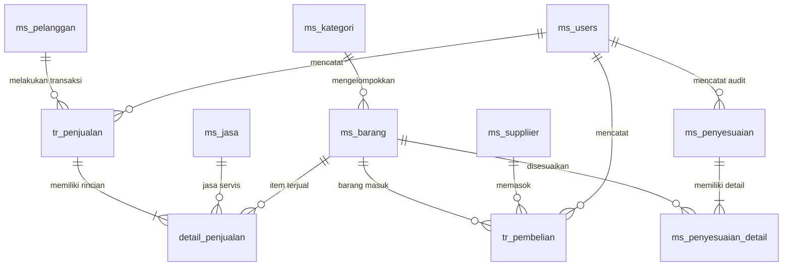
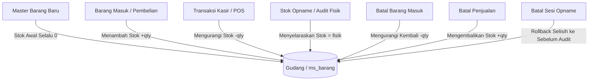
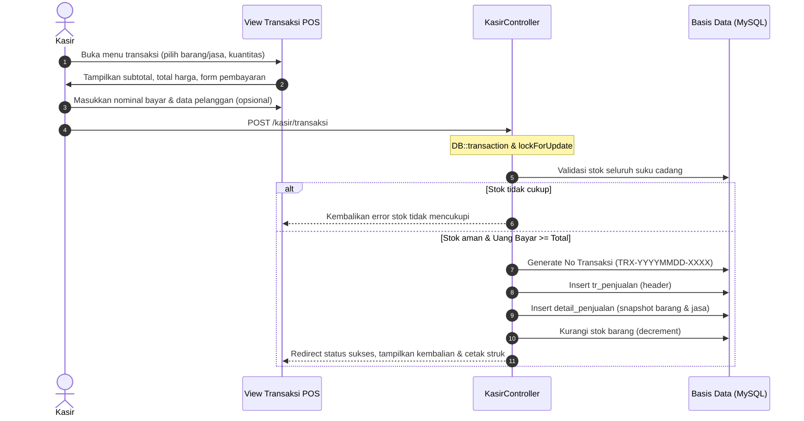
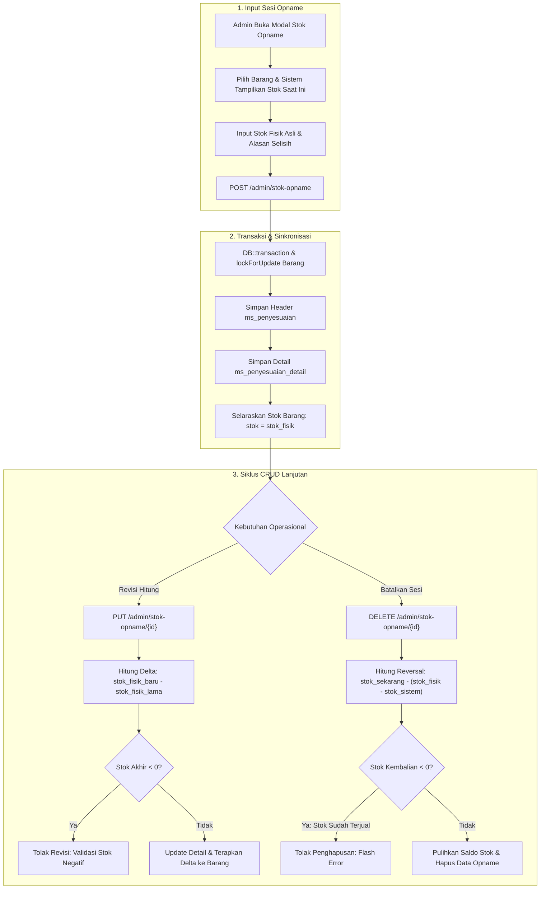

# Dokumentasi Lengkap Alur dan Sistem POS Bengkel & Toko Pradan Motor

Dokumen ini menjelaskan secara menyeluruh arsitektur, alur bisnis, basis data, modul kontroler, antarmuka, serta aturan bisnis yang diterapkan pada **Sistem Informasi POS (Point of Sale) & Manajemen Bengkel Motor Pradan Motor**.

---

## 1. Ikhtisar Sistem (System Overview)

Sistem POS Pradan Motor adalah aplikasi berbasis web yang dikembangkan menggunakan **Laravel (PHP 8.4)**, **Tailwind CSS**, dan **MySQL/SQLite**. Sistem ini dirancang untuk menangani operasional harian bengkel motor dan penjualan suku cadang, mencakup:
- Pengadaan dan mutasi barang masuk (pembelian dari supplier).
- Penjualan kasir (Point of Sale) untuk suku cadang dan jasa servis.
- Manajemen stok dan audit fisik (Stok Opname).
- Pengelolaan master data pelanggan, pengguna, supplier, kategori, dan layanan jasa.
- Pelaporan dan analitik transaksi berkala.

Sistem membagi hak akses ke dalam dua peran utama (**Role-Based Access Control**):
1. **Admin**: Pengelola penuh seluruh master data, inventaris (barang masuk & stok opname), pembatalan transaksi, akun pengguna, serta rekapitulasi laporan mendalam.
2. **Kasir**: Pengelola transaksi POS harian di meja kasir, pendaftaran data pelanggan servis, pemantauan stok suku cadang secara *read-only*, riwayat transaksi, dan laporan rekap kasir.

---

## 2. Struktur Basis Data, Entitas & Pemetaan Migration

Sistem menggunakan penamaan tabel dengan prefix `ms_` (*Master*) dan `tr_` (*Transaction*). Seluruh primary key menggunakan format eksplisit seperti `id_user`, `id_barang`, `id_transaksi` (bukan default `id`).

### A. Tabel Utama & Skema ERD



---

### B. Pemetaan Lengkap File Migration & Struktur Tabel

Berikut adalah urutan eksekusi migration, struktur kolom, indeks, dan *foreign key constraint* yang diterapkan pada basis data:

#### 1. `0001_01_01_000000_create_users_table.php` (Tabel Sistem Bawaan)
- **Tabel `users`**: Skema autentikasi bawaan Laravel (`id`, `name`, `email`, `email_verified_at`, `password`, `remember_token`, timestamps).
- **Tabel `password_reset_tokens`**: Token reset sandi (`email`, `token`, `created_at`).
- **Tabel `sessions`**: Penyimpanan sesi berbasis database (`id`, `user_id`, `ip_address`, `user_agent`, `payload`, `last_activity`).

#### 2. `0001_01_01_000001_create_cache_table.php`
- **Tabel `cache`** & **`cache_locks`**: Manajemen cache aplikasi berbasis database.

#### 3. `0001_01_01_000002_create_jobs_table.php`
- **Tabel `jobs`**, **`job_batches`**, & **`failed_jobs`**: Antrean pekerjaan latar belakang (*background queue*).

#### 4. `2026_10_18_000001_create_ms_users_table.php` (Master Pengguna POS)
- **Nama Tabel**: `ms_users`
- **Tujuan**: Menyimpan data pegawai bengkel (Admin & Kasir) yang terpisah dari tabel auth generik.
- **Kolom**:
  - `id_user` (`increments`, PK): ID pengguna.
  - `nama` (`string(50)`): Nama lengkap pengguna.
  - `email` (`string(50)`): Alamat email unik (`uq_users_email`).
  - `password` (`string(60)`): Password ter-hash (Bcrypt).
  - `role` (`enum('admin', 'kasir')`, default: `'kasir'`): Peran hak akses.
  - `status` (`enum('aktif', 'nonaktif')`, default: `'aktif'`): Status operasional akun.
  - `created_at` & `updated_at`: Timestamp sistem.

#### 5. `2026_10_18_000002_create_ms_kategori_table.php` (Master Kategori)
- **Nama Tabel**: `ms_kategori`
- **Tujuan**: Klasifikasi jenis suku cadang (misal: Oli, Busi, Ban, Kampas Rem).
- **Kolom**:
  - `id_kategori` (`increments`, PK): ID kategori.
  - `nama_kategori` (`string(25)`): Nama kategori (`unique`).

#### 6. `2026_10_18_000003_create_ms_suppliier_table.php` (Master Supplier)
- **Nama Tabel**: `ms_suppliier` *(Catatan: Penamaan mempertahankan double 'i' sesuai rancangan skema awal MySQL Workbench)*
- **Tujuan**: Direktori pemasok suku cadang resmi / grosir.
- **Kolom**:
  - `id_supplier` (`increments`, PK): ID supplier.
  - `nama_supplier` (`string(50)`): Nama badan usaha / supplier (`index: idx_supplier_nama`).
  - `no_telepon` (`string(15)`, nullable): Kontak telepon.
  - `alamat` (`string(255)`, nullable): Alamat supplier.

#### 7. `2026_10_18_000004_create_ms_pelanggan_table.php` (Master Pelanggan)
- **Nama Tabel**: `ms_pelanggan`
- **Tujuan**: Buku data pelanggan bengkel (nama, plat motor, dan nomor HP).
- **Kolom**:
  - `id_pelanggan` (`increments`, PK): ID pelanggan.
  - `nama` (`string(50)`): Nama pemilik kendaraan (`index: idx_pelanggan_nama`).
  - `plat_nomor` (`string(12)`, nullable): Nomor polisi kendaraan (`index: idx_pelanggan_plat`).
  - `no_telepon` (`string(15)`, nullable): Nomor kontak/WhatsApp.
  - `created_at`: Waktu pertama kali terdaftar.

#### 8. `2026_10_18_000005_create_ms_jasa_table.php` (Master Layanan / Servis)
- **Nama Tabel**: `ms_jasa`
- **Tujuan**: Katalog biaya ongkos kerja servis motor di bengkel.
- **Kolom**:
  - `id_jasa` (`increments`, PK): ID jasa servis.
  - `nama_jasa` (`string(120)`): Nama tindakan servis (misal: "Tune Up Injeksi", "Ganti Ban Luar") (`unique`).
  - `tarif` (`integer`, default: `0`): Besaran ongkos servis dalam Rupiah.

#### 9. `2026_10_18_000006_create_ms_barang_table.php` (Master Suku Cadang & Stok)
- **Nama Tabel**: `ms_barang`
- **Tujuan**: Katalog suku cadang motor beserta saldo stok aktif gudang.
- **Kolom**:
  - `id_barang` (`increments`, PK): ID suku cadang.
  - `id_kategori` (`unsignedInteger`): Relasi kategori (`index: idx_barang_kategori`).
  - `nama_barang` (`string(30)`): Nama produk (`index: idx_barang_nama`).
  - `satuan` (`string(20)`, default: `'pcs'`): Unit takaran (Pcs, Botol, Set, Tube).
  - `harga_jual` (`integer`, default: `0`): Harga jual konsumen di kasir (Rp).
  - `stok` (`integer`, default: `0`): Jumlah unit fisik yang tersedia di bengkel.
  - `created_at` & `updated_at`: Waktu pencatatan & update stok.
- **Foreign Key**:
  - `fk_barang_kategori`: `id_kategori` $\rightarrow$ `ms_kategori(id_kategori)` (`onUpdate: cascade`, `onDelete: restrict`).

#### 10. `2026_10_18_000007_create_tr_penjualan_table.php` (Transaksi Penjualan POS - Header)
- **Nama Tabel**: `tr_penjualan`
- **Tujuan**: Header faktur/nota transaksi kasir POS.
- **Kolom**:
  - `id_transaksi` (`increments`, PK): ID nota penjualan.
  - `id_user` (`unsignedInteger`): Kasir yang melayani transaksi (`index: idx_transaksi_user`).
  - `id_pelanggan` (`unsignedInteger`, nullable): Pelanggan terkait (`index: idx_transaksi_pelanggan`).
  - `id_kendaraan` (`unsignedInteger`, nullable): Kolom cadangan identitas motor servis.
  - `no_transaksi` (`string(25)`): Nomor nota unik (contoh: `TRX-20261115-0001`, `unique`).
  - `tanggal` (`dateTime`): Waktu transaksi (`index: idx_transaksi_tanggal`).
  - `total` (`integer`, default: `0`): Total tagihan kotor belanja suku cadang + jasa.
  - `nominal_bayar` (`integer`, default: `0`): Uang tunai yang diserahkan pelanggan.
  - `kembalian` (`integer`, nullable): Selisih uang kembalian.
- **Foreign Keys**:
  - `fk_transaksi_user`: `id_user` $\rightarrow$ `ms_users(id_user)` (`cascadeOnUpdate`, `restrictOnDelete`).
  - `fk_transaksi_pelanggan`: `id_pelanggan` $\rightarrow$ `ms_pelanggan(id_pelanggan)` (`cascadeOnUpdate`, `nullOnDelete` - *soft disconnect*).

#### 11. `2026_10_18_000008_create_detail_penjualan_table.php` (Detail Penjualan POS)
- **Nama Tabel**: `detail_penjualan`
- **Tujuan**: Rincian setiap suku cadang atau jasa servis yang dibeli dalam satu transaksi.
- **Kolom**:
  - `id_detail` (`increments`, PK): ID baris belanja.
  - `id_transaksi` (`unsignedInteger`): Relasi ke header nota (`index: idx_dtrx_transaksi`).
  - `id_barang` (`unsignedInteger`, nullable): Relasi ke suku cadang (`index: idx_dtrx_barang`).
  - `id_jasa` (`unsignedInteger`, nullable): Relasi ke jasa servis (`index: idx_dtrx_jasa`).
  - `jenis_item` (`enum('barang', 'jasa')`): Pembeda tipe baris transaksi.
  - `nama_item` (`string(100)`): *Snapshot* nama barang/jasa saat nota dicetak.
  - `harga_satuan` (`integer`): *Snapshot* tarif/harga jual per unit.
  - `qty` (`integer`, default: `1`): Jumlah kuantitas belanja/pengerjaan.
  - `subtotal` (`integer`, nullable): Hasil kali `harga_satuan * qty`.
- **Foreign Keys**:
  - `fk_dtrx_transaksi`: `id_transaksi` $\rightarrow$ `tr_penjualan(id_transaksi)` (`cascadeOnUpdate`, `cascadeOnDelete`).
  - `fk_dtrx_barang`: `id_barang` $\rightarrow$ `ms_barang(id_barang)` (`restrictOnDelete`).
  - `fk_dtrx_jasa`: `id_jasa` $\rightarrow$ `ms_jasa(id_jasa)` (`restrictOnDelete`).

#### 12. `2026_10_18_000009_create_tr_pembelian_table.php` (Barang Masuk / Pembelian)
- **Nama Tabel**: `tr_pembelian`
- **Tujuan**: Riwayat pasokan suku cadang dari supplier (menambah stok gudang).
- **Kolom**:
  - `id_tr_pembelian` (`increments`, PK): ID catatan pengadaan.
  - `id_barang` (`unsignedInteger`, nullable): Suku cadang yang dibeli (`index: fk_tr_pembelian_ms_barang1_idx`).
  - `id_supplier` (`unsignedInteger`): Pemasok pengirim (`index: idx_bm_supplier`).
  - `id_user` (`unsignedInteger`): Petugas penerima pasokan (`index: idx_bm_user`).
  - `no_referensi` (`string(25)`): Nomor surat jalan / faktur supplier (contoh: `BM-202611-001`, `unique`).
  - `tanggal` (`date`): Tanggal pengiriman barang (`index: idx_bm_tanggal`).
  - `jumlah` (`integer`, nullable): Jumlah kuantitas barang yang diterima.
  - `harga_beli` (`integer`, nullable): Harga beli per unit dari supplier (HPP).
  - `subtotal` (`integer`, nullable): Total belanja pengadaan (`jumlah * harga_beli`).
  - `keterangan` (`string(255)`, nullable): Catatan kondisi fisik barang atau termin pembayaran.
  - `created_at`: Waktu sistem mencatat penerimaan.
- **Foreign Keys**:
  - `fk_bm_supplier`: `id_supplier` $\rightarrow$ `ms_suppliier(id_supplier)` (`cascadeOnUpdate`, `restrictOnDelete`).
  - `fk_bm_user`: `id_user` $\rightarrow$ `ms_users(id_user)` (`cascadeOnUpdate`, `restrictOnDelete`).
  - `fk_tr_pembelian_ms_barang1`: `id_barang` $\rightarrow$ `ms_barang(id_barang)` (`noActionOnUpdate`, `noActionOnDelete`).

#### 13. `2026_10_18_000010_create_ms_penyesuaian_table.php` (Stok Opname - Header)
- **Nama Tabel**: `ms_penyesuaian`
- **Tujuan**: Header sesi audit penghitungan fisik suku cadang.
- **Kolom**:
  - `id_opname` (`increments`, PK): Nomor audit penyesuaian.
  - `id_user` (`unsignedInteger`): Petugas/Admin yang melakukan audit (`index: idx_opname_user`).
  - `tanggal` (`dateTime`): Waktu pemeriksaan fisik dilakukan.
  - `keterangan` (`string(255)`, nullable): Penjelasan sesi audit (contoh: *"Audit Rutin Akhir Bulan"*).
- **Foreign Key**:
  - `fk_opname_user`: `id_user` $\rightarrow$ `ms_users(id_user)` (`cascadeOnUpdate`, `restrictOnDelete`).

#### 14. `2026_10_18_000011_create_ms_penyesuaian_detail_table.php` (Stok Opname - Detail)
- **Nama Tabel**: `ms_penyesuaian_detail`
- **Tujuan**: Rincian perbandingan hitung fisik vs sistem untuk setiap suku cadang yang diaudit.
- **Kolom**:
  - `id_detail` (`increments`, PK): ID baris audit.
  - `id_opname` (`unsignedInteger`): Relasi ke header sesi audit (`index: idx_dso_opname`).
  - `id_barang` (`unsignedInteger`): Suku cadang yang diaudit (`index: idx_dso_barang`).
  - `stok_sistem` (`integer`): Saldo stok komputer sesaat sebelum audit.
  - `stok_fisik` (`integer`): Saldo aktual hasil hitung manual di rak.
  - `alasan` (`text`): Keterangan penyebab selisih (pecah, hilang, salah hitung, dll.).
- **Foreign Keys**:
  - `fk_dso_opname`: `id_opname` $\rightarrow$ `ms_penyesuaian(id_opname)` (`cascadeOnUpdate`, `cascadeOnDelete`).
  - `fk_dso_barang`: `id_barang` $\rightarrow$ `ms_barang(id_barang)` (`cascadeOnUpdate`, `restrictOnDelete`).

---

## 3. Arsitektur Keamanan & Autentikasi

### Alur Autentikasi & Brute-Force Protection
1. **Login Throttle**: Dilindungi oleh `RateLimiter` dengan kunci kombinasi `email|ip`. Jika terjadi 5 kali kegagalan login dalam 60 detik, sistem akan mengunci proses login dan menampilkan sisa waktu tunggu (detik).
2. **Validasi Kredensial**: Menggunakan `Auth::attempt()`.
3. **Pengecekan Status Aktif**:
   - Jika `status !== 'aktif'`, sesi langsung di-logout, session di-invalidate, dan pengguna menerima pesan kesalahan: *"Akun Anda telah dinonaktifkan. Silakan hubungi administrator."*
4. **Middleware `EnsureUserIsActive`**:
   - Didaftarkan secara global pada grup `web`. Setiap request memeriksa status pengguna yang sedang login. Jika akun dinonaktifkan di tengah sesi oleh Admin, pengguna otomatis di-logout.
5. **Middleware `EnsureUserIsAdmin`** (alias: `admin`):
   - Melindungi seluruh endpoint `/admin/*`. Mengeluarkan `abort(403)` jika peran pengguna bukan `admin`.

---

## 4. Alur Bisnis Inti (Core Business Flows)

### A. Alur Siklus Hidup Stok (Stock Management Lifecycle)

Perubahan stok barang diatur secara terpusat dengan aturan integritas ketat menggunakan transaksi database atomik (`DB::transaction`) dan penguncian baris (`lockForUpdate`):



1. **Aturan Barang Baru**:
   - Saat Admin menambahkan barang baru melalui menu **Master Barang**, stok **selalu diinisialisasi 0**. Stok tidak boleh diisi manual dari form master barang.
2. **Penambahan Stok (Barang Masuk)**:
   - Satu-satunya jalan legal untuk menambah stok masuk adalah melalui modul **Barang Masuk (`tr_pembelian`)**.
   - Stok bertambah secara atomik: `$barang->increment('stok', $jumlah)`.
3. **Pengurangan Stok (Transaksi POS)**:
   - Kasir memproses transaksi penjualan barang.
   - Sistem mengunci baris barang, memvalidasi ketersediaan stok (`stok >= qty`), kemudian mengurangi stok: `$barang->decrement('stok', $qty)`.
4. **Penyesuaian Fisik (Stok Opname)**:
   - Digunakan saat audit berkala untuk menyelaraskan selisih antara stok sistem dan fisik di rak bengkel.
   - Sistem mencatat snapshot `stok_sistem` sebelum perubahan, mencatat `stok_fisik`, serta menghitung selisih.
   - Stok barang langsung disinkronkan ke angka fisik: `$barang->update(['stok' => $stok_fisik])`.
5. **Perlindungan Pembatalan (Anti-Negative Stock Reversal)**:
   - Jika transaksi barang masuk, penjualan, atau stok opname dibatalkan/dihapus, sistem menghitung apakah pengembalian stok akan menyebabkan stok menjadi negatif (akibat barang sudah terlanjur terjual pada transaksi lain). Jika berpotensi negatif, penghapusan **ditolak** demi menjaga konsistensi inventaris.

---

### B. Alur Transaksi Kasir (Point of Sale Flow)



- **Snapshot Data**: Pada `detail_penjualan`, nama item dan harga satuan dicatat sebagai snapshot saat transaksi dibuat. Perubahan harga master di kemudian hari tidak akan merusak riwayat transaksi lampau.
- **Dukungan Multi-Item Campuran**: Dalam satu struk/transaksi, kasir dapat menggabungkan barang (suku cadang/oli) dan jasa (servis ringan, ganti oli, tune up) secara fleksibel.

---

### C. Alur Lengkap & Rinci Modul Stok Opname (Penyesuaian Stok Fisik)

Modul **Stok Opname** dirancang untuk menangani audit fisik suku cadang secara berkala. Perbedaan antara stok sistem komputer dan fisik di rak gudang (akibat barang pecah/bocor, hilang, salah hitung penerimaan, atau barang aus) diselaraskan secara akurat dengan tetap menjaga rekam jejak audit (*audit trail*).



#### 1. Struktur Entitas & Data Snapshot
- **Tabel Header (`ms_penyesuaian`)**:
  - `id_opname` (PK): Identitas unik sesi audit.
  - `id_user` (FK): Admin/petugas pencatat audit.
  - `tanggal`: Tanggal dan jam pelaksanaan audit.
  - `keterangan`: Catatan sesi (misal: *"Audit Rutin Akhir Bulan"*).
- **Tabel Detail (`ms_penyesuaian_detail`)**:
  - `id_detail` (PK): Identitas baris audit.
  - `id_opname` (FK): Terhubung ke sesi opname (cascade delete saat header dihapus).
  - `id_barang` (FK): Barang yang diperiksa.
  - `stok_sistem`: Nilai snapshot stok di sistem **sebelum** audit dilakukan.
  - `stok_fisik`: Jumlah fisik aktual hasil penghitungan manual di etalase/gudang.
  - `alasan`: Penjelasan wajib mengapa terjadi selisih (misal: *"1 botol oli kemasan bocor"*).

#### 2. Logika Operasi CRUD Stok Opname

##### A. CREATE (Penyimpanan Sesi Baru - `store`)
- **Dukungan Format Fleksibel**:
  - **Single Item**: Input cepat melalui modal web standar (`id_barang`, `stok_fisik`, `alasan`, `tanggal`, `keterangan`).
  - **Batch Multi-Item**: Menerima array `items` (`items.*.id_barang`, `items.*.stok_fisik`, `items.*.alasan`) untuk kebutuhan audit borongan banyak suku cadang dalam satu sesi.
- **Validasi Data**:
  - Tanggal wajib diisi.
  - ID barang harus valid di `ms_barang`.
  - Stok fisik wajib bilangan bulat $\ge 0$.
  - Alasan selisih wajib diisi (maks. 500 karakter).
- **Eksekusi Database**:
  - Berjalan dalam `DB::transaction()`.
  - Mengunci baris barang dengan `Barang::where(...)->lockForUpdate()`.
  - Mengambil stok terkini sebagai nilai snapshot `stok_sistem`.
  - Menyimpan record `ms_penyesuaian` dan `ms_penyesuaian_detail`.
  - **Sinkronisasi Saldo**: Langsung meng-update saldo master barang: `$barang->update(['stok' => $stok_fisik])`.

##### B. READ (Tampilan Tabel, Metrik, & Modal Detail - `index`)
- **Metrik Ringkasan (Cards)**:
  - *Total Sesi Opname*: Jumlah sesi audit yang telah tercatat.
  - *Item Diperiksa*: Total baris barang yang pernah diaudit (`OpnameDetail::count()`).
  - *Item Selisih*: Jumlah pemeriksaan yang mengalami perbedaan fisik vs sistem (`stok_fisik != stok_sistem`).
  - *Total Suku Cadang*: Jumlah total produk suku cadang terdaftar di bengkel.
- **Tabel Daftar Sesi**:
  - Menampilkan nomor, tanggal/jam terformat bahasa Indonesia, jumlah item (lengkap dengan nama cuplikan barang), badge status selisih (*"X Ada Selisih"* [merah] / *"Semua Sesuai"* [hijau]), keterangan sesi, petugas pencatat, serta tombol aksi.
- **Modal Detail**:
  - Menampilkan dialog rincian barang, satuan, kategori, stok sistem awal, stok fisik asli, badge selisih (`+X` hijau, `-X` merah, atau `Sesuai (0)` abu-abu), dan alasan selisih.
- **Opsi Dropdown Interaktif**:
  - Dropdown pemilihan barang di modal input menyertakan stok sistem saat ini (contoh: `Oli MPX2 (Stok Sistem: 12 Botol)`), memudahkan admin membandingkan langsung saat input.

##### C. UPDATE (Revisi Hitungan Audit - `update`)
- Digunakan apabila petugas salah mencatat hitungan fisik atau menemukan suku cadang yang terselip setelah sesi opname disimpan.
- **Perhitungan Delta Otomatis**:
  $$\Delta = \text{stok\_fisik\_baru} - \text{stok\_fisik\_lama}$$
  $$\text{stok\_sistem\_baru} = \text{stok\_saat\_ini} + \Delta$$
- **Proteksi Stok Negatif**:
  - Jika barang telah terjual pada transaksi kasir setelah opname, dan revisi baru menurunkan fisik secara drastis sehingga saldo sistem menjadi $< 0$, sistem melempar `ValidationException` dan menolak perubahan:
    *"Perubahan stok fisik pada barang 'X' mengakibatkan stok akhir sistem menjadi negatif (Y). Transaksi lain mungkin telah menggunakan stok ini."*
- Jika valid, saldo barang disesuaikan dengan nilai delta, dan detail opname diperbarui.

##### D. DELETE (Pembatalan Sesi & Rollback Stok - `destroy`)
- Menghapus catatan sesi opname sekaligus **mengembalikan saldo stok ke kondisi sebelum opname dilakukan**.
- **Rumus Pemulihan Saldo**:
  $$\text{penyesuaian} = \text{stok\_fisik} - \text{stok\_sistem}$$
  $$\text{stok\_pulih} = \text{stok\_saat\_ini} - \text{penyesuaian}$$
- **Contoh Kasus**:
  1. *Audit Berkurang*: Stok sistem 10, fisik 8 (penyesuaian $-2$). Saat sesi opname dibatalkan, stok dikembalikan: $8 - (-2) = 10$.
  2. *Audit Bertambah*: Stok sistem 5, fisik 12 (penyesuaian $+7$). Saat sesi opname dibatalkan, stok dikurangi kembali: $12 - (+7) = 5$.
- **Proteksi Anti-Negative Rollback**:
  - Jika pada kasus penambahan fisik ($+7$) barang tersebut kemudian terjual di kasir sebanyak 10 pcs sehingga sisa stok saat ini tinggal 2 pcs, pembatalan opname (yang butuh mengurangi 7 pcs) akan menghasilkan $2 - 7 = -5$.
  - Sistem mendeteksi kondisi $\text{stok\_pulih} < 0$, membatalkan transaksi rollback, dan menampilkan flash error:
    *"Penghapusan ditolak: Stok barang saat ini tidak mencukupi untuk dikembalikan ke stok sebelum opname karena sebagian stok telah digunakan pada transaksi lain."*
- **Modal Konfirmasi Berperingatan**:
  - Modal hapus menyajikan rincian prediksi pergerakan stok untuk setiap barang sebelum admin menekan konfirmasi hapus.

---

### D. Alur Integritas Penghapusan Master Data

Untuk menjamin referential integrity database tanpa merusak rekam jejak keuangan:
- **Barang**: Tidak dapat dihapus jika sudah memiliki riwayat pada `tr_pembelian`, `detail_penjualan`, atau `ms_penyesuaian_detail`.
- **Kategori**: Tidak dapat dihapus jika masih ada barang yang terhubung ke kategori tersebut.
- **Supplier**: Tidak dapat dihapus jika sudah memiliki riwayat pengadaan barang masuk (`tr_pembelian`).
- **Layanan Jasa**: Tidak dapat dihapus jika pernah masuk dalam transaksi servis (`detail_penjualan`).
- **Pelanggan**: Menggunakan mekanisme **soft-disconnect**; saat pelanggan dihapus, relasi `id_pelanggan` pada tabel `tr_penjualan` diubah menjadi `NULL`, sehingga data transaksi keuangan tetap utuh.
- **Pengguna/Admin**: Admin tidak diperbolehkan menghapus atau menonaktifkan akunnya sendiri.

---

## 5. Peta Rute & Modul Sistem (Routing Map)

### Rute Publik & Autentikasi
| Method | URI | Nama Rute | Kontroler / Handler | Keterangan |
|---|---|---|---|---|
| `GET` | `/` | - | Closure | Redirect ke dashboard sesuai peran atau ke login |
| `GET` | `/login` | `login` | `AuthController@showLoginForm` | Form login |
| `POST` | `/login` | - | `AuthController@login` | Proses autentikasi & rate limiting |
| `POST` | `/logout` | `logout` | Closure / `AuthController@logout` | Logout sesi aktif |
| `POST` | `/profil/password` | `profile.password.update` | Closure | Ganti password mandiri (auth) |

### Modul Kasir (`/kasir/*` - Middleware: `auth`)
| Method | URI | Nama Rute | Kontroler | Fungsi |
|---|---|---|---|---|
| `GET` | `/kasir/dashboard` | `kasir.dashboard` | `KasirController@dashboard` | Ringkasan penjualan kasir & suku cadang menipis |
| `GET` | `/kasir/transaksi` | `kasir.transaksi` | `KasirController@transaksi` | Antarmuka kasir POS |
| `POST` | `/kasir/transaksi` | `kasir.transaksi.store` | `KasirController@storeTransaksi` | Pemrosesan pembayaran & pemotongan stok |
| `GET` | `/kasir/pelanggan` | `kasir.pelanggan` | `Kasir\PelangganController@index` | Daftar pelanggan bengkel |
| `POST` | `/kasir/pelanggan` | `kasir.pelanggan.store` | `Kasir\PelangganController@store` | Pendaftaran pelanggan baru |
| `PUT` | `/kasir/pelanggan/{id}` | `kasir.pelanggan.update` | `Kasir\PelangganController@update` | Pembaruan data pelanggan |
| `DELETE`| `/kasir/pelanggan/{id}` | `kasir.pelanggan.destroy` | `Kasir\PelangganController@destroy`| Hapus pelanggan (soft-disconnect) |
| `GET` | `/kasir/stok` | `kasir.stok` | `KasirController@stok` | Katalog & sisa stok barang (Read-Only) |
| `GET` | `/kasir/riwayat` | `kasir.riwayat` | `KasirController@riwayat` | Daftar riwayat transaksi kasir |
| `GET` | `/kasir/laporan` | `kasir.laporan` | `KasirController@laporan` | Rekapitulasi penjualan & setoran kasir |
| `GET` | `/kasir/profil` | `kasir.profil` | `KasirController@profil` | Profil akun kasir |

### Modul Admin (`/admin/*` - Middleware: `auth`, `admin`)
| Method | URI | Nama Rute | Kontroler | Fungsi |
|---|---|---|---|---|
| `GET` | `/admin/dashboard` | `admin.dashboard` | `Admin\DashboardController@index` | Analitik omzet, transaksi, stok menipis |
| `GET` | `/admin/pengguna` | `admin.pengguna` | `Admin\PenggunaController@index` | CRUD Akun Pegawai (Admin/Kasir) |
| `POST` | `/admin/pengguna` | `admin.pengguna.store` | `Admin\PenggunaController@store` | Tambah pengguna baru |
| `PUT` | `/admin/pengguna/{id}` | `admin.pengguna.update`| `Admin\PenggunaController@update`| Edit peran/status pengguna |
| `DELETE`| `/admin/pengguna/{id}` | `admin.pengguna.destroy`| `Admin\PenggunaController@destroy`| Hapus pengguna |
| `GET` | `/admin/barang` | `admin.barang` | `Admin\BarangController@index` | CRUD Master Suku Cadang |
| `POST` | `/admin/barang` | `admin.barang.store` | `Admin\BarangController@store` | Simpan barang baru (stok otomatis 0) |
| `PUT` | `/admin/barang/{id}` | `admin.barang.update` | `Admin\BarangController@update` | Edit nama/harga barang (tanpa ubah stok)|
| `DELETE`| `/admin/barang/{id}` | `admin.barang.destroy` | `Admin\BarangController@destroy` | Hapus barang jika belum bertransaksi |
| `GET` | `/admin/kategori` | `admin.kategori` | `Admin\KategoriController@index` | CRUD Kategori Suku Cadang |
| `GET` | `/admin/supplier` | `admin.supplier` | `Admin\SupplierController@index` | CRUD Master Supplier |
| `GET` | `/admin/layanan` | `admin.layanan` | `Admin\LayananController@index` | CRUD Jasa Servis & Tarif |
| `GET` | `/admin/pelanggan` | `admin.pelanggan` | `Admin\PelangganController@index` | CRUD Pelanggan Bengkel |
| `GET` | `/admin/barang-masuk` | `admin.barang-masuk` | `Admin\BarangMasukController@index` | Daftar penerimaan pasokan barang |
| `POST` | `/admin/barang-masuk` | `admin.barang-masuk.store`| `Admin\BarangMasukController@store`| Tambah stok masuk (single/batch) |
| `DELETE`| `/admin/barang-masuk/{id}`| `admin.barang-masuk.destroy`| `Admin\BarangMasukController@destroy`| Batalkan penerimaan & kurangi stok |
| `GET` | `/admin/stok-opname` | `admin.stok-opname` | `Admin\StokOpnameController@index` | Daftar audit penyesuaian stok opname |
| `POST` | `/admin/stok-opname` | `admin.stok-opname.store`| `Admin\StokOpnameController@store` | Input audit fisik & selaraskan stok |
| `PUT` | `/admin/stok-opname/{id}`| `admin.stok-opname.update`| `Admin\StokOpnameController@update`| Revisi audit fisik & update selisih |
| `DELETE`| `/admin/stok-opname/{id}`| `admin.stok-opname.destroy`| `Admin\StokOpnameController@destroy`| Batalkan opname & kembalikan stok |
| `GET` | `/admin/riwayat` | `admin.riwayat` | `Admin\RiwayatController@index` | Riwayat transaksi seluruh kasir |
| `DELETE`| `/admin/riwayat/{id}` | `admin.riwayat.destroy` | `Admin\RiwayatController@destroy` | Batalkan transaksi POS & kembalikan stok|
| `GET` | `/admin/laporan` | `admin.laporan` | `Admin\LaporanController@index` | Laporan Penjualan, Pembelian, Stok, Jasa |
| `GET` | `/admin/profil` | `admin.profil` | `Admin\ProfilController@index` | Profil akun admin |

---

## 6. Modul Pelaporan (Reporting Engine)

Modul laporan terpusat pada `Admin\LaporanController` dan dapat difilter berdasarkan rentang tanggal (`tanggal_mulai` s/d `tanggal_akhir`) serta tipe laporan:
1. **Laporan Penjualan (POS)**: Menghitung omzet kotor, total transaksi, rata-rata nilai transaksi, dan rincian kasir pencatat.
2. **Laporan Pembelian (Barang Masuk)**: Menghitung total belanja pengadaan suku cadang, jumlah item masuk, dan rekap supplier.
3. **Laporan Mutasi Stok (Stok Opname)**: Menampilkan catatan audit barang, stok sistem vs fisik, akumulasi unit selisih, dan alasan selisih.
4. **Laporan Jasa Servis**: Menampilkan volume pengerjaan jasa mekanik, pendapatan jasa servis, dan frekuensi pengerjaan.

---

## 7. Desain Komponen UI (Blade Components)

Aplikasi dibangun dengan komponen UI modular yang dapat digunakan kembali di folder `resources/views/components/`:
- `<x-page-header>`: Judul halaman, sub-judul, ikon halaman, dan slot tombol aksi.
- `<x-summary-card>`: Kartu metrik ringkasan dengan ikon, angka, dan badge indikator status.
- `<x-table>`: Tabel responsif lengkap dengan fitur pencarian instan sisi klien (`searchable="true"`).
- `<x-modal>`: Modal dialog standar dengan konfigurasi dinamis untuk Form POST, PUT, DELETE, maupun konfirmasi peringatan bahaya (`danger`).
- `<x-button-action>`: Tombol aksi miniatur tabel untuk `info` (lihat detail), `edit`, `delete`, dan `print`.
- `<x-badge>`: Label status berwarna (`success`, `danger`, `warning`, `info`).
- `<x-input>` & `<x-select>`: Input form terpadu dengan label, pesan validasi otomatis, dan atribut aksesibilitas.
- `<x-sidebar>` & `<x-topbar>`: Navigasi samping dan atas yang menyesuaikan menu aktif berdasarkan peran (`Admin` / `Kasir`).
- **Global Submit Button Loading & Anti-Double Submit**: Seluruh tombol simpan/submit pada form (POST/PUT/DELETE) otomatis menampilkan animasi spinner loading (`Menyimpan...`, `Memproses...`, atau `Menghapus...`) dan menonaktifkan tombol secara instan guna mencegah pengiriman ganda (double-submit).
- **Universal Modal Alert (`#modal-global-alert`)**: Pengganti alert popup browser (`window.alert()`) yang menggunakan komponen `<x-modal size="sm">` dengan ikon status dinamis (warning, danger, success, info).

---

## 8. Panduan Verifikasi & Testing

Seluruh alur logika bisnis, integritas stok, serta pembatasan hak akses diuji melalui rangkaian Automated Feature Tests di `tests/Feature/AdminCrudTest.php` dan `tests/Feature/ExampleTest.php`:
- Pengujian autentikasi (brute force limiter, akun nonaktif, peran kasir vs admin).
- Pengujian CRUD seluruh master data beserta validasi batas karakter dan keunikan nilai.
- Pengujian penambahan stok otomatis lewat barang masuk (single & batch) dan pembatalannya.
- Pengujian pemotongan stok otomatis saat penjualan kasir POS dan penolakan saat stok kurang.
- Pengujian siklus hidup stok opname (sinkronisasi stok fisik, revisi edit, pembatalan/rollback, dan proteksi stok negatif).
- Pengujian pembatalan transaksi kasir oleh admin beserta pengembalian unit suku cadang ke rak.

Perintah untuk menjalankan pengujian:
```bash
php vendor/phpunit/phpunit/phpunit
```
*(Seluruh 41 pengujian dan 248 asersi berada dalam status lulus/green).*

